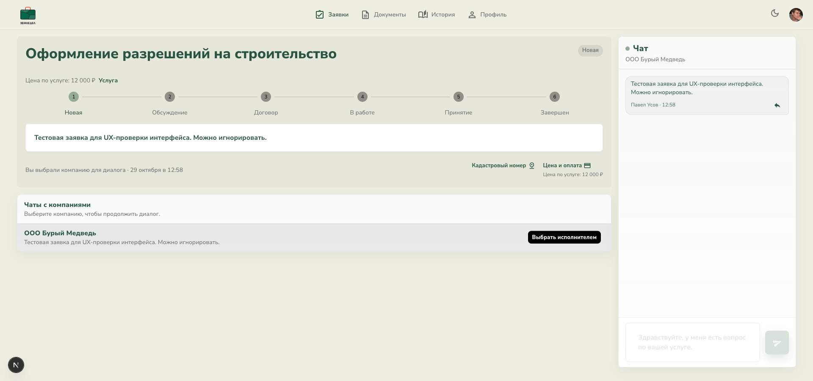
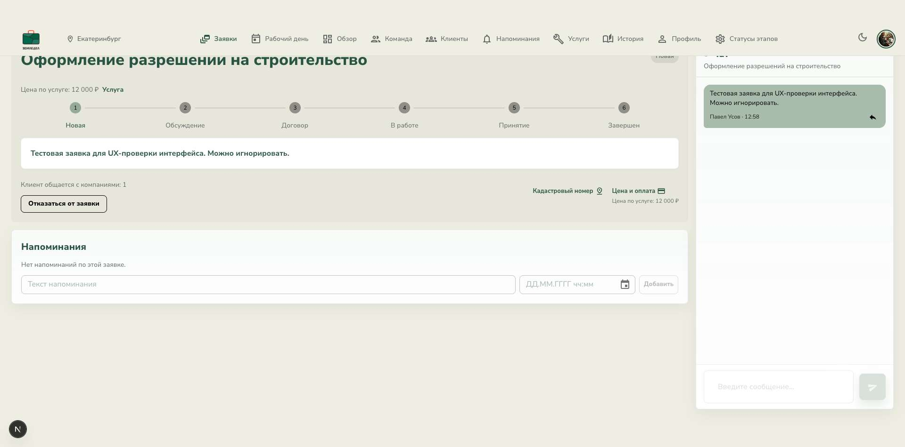
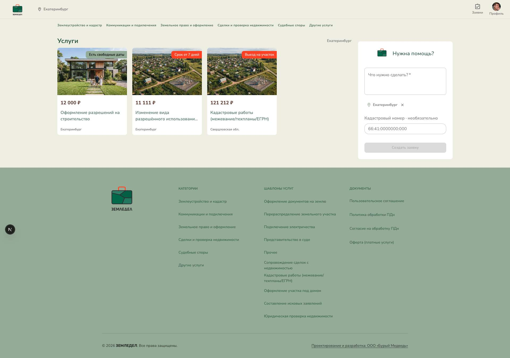
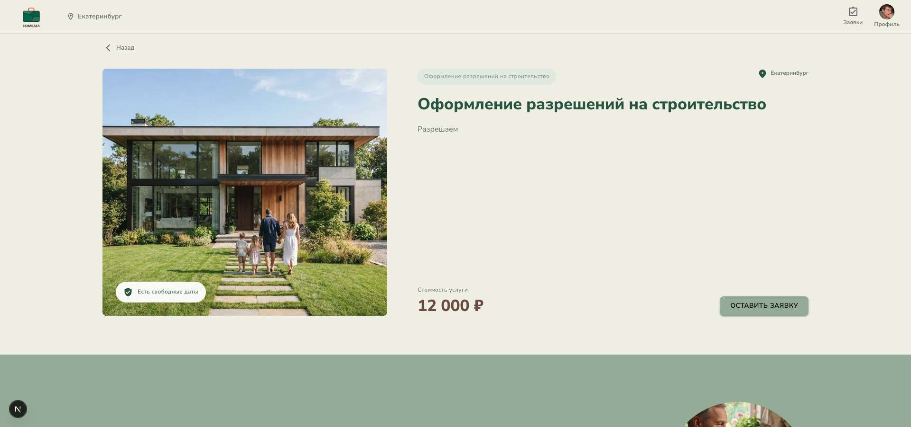
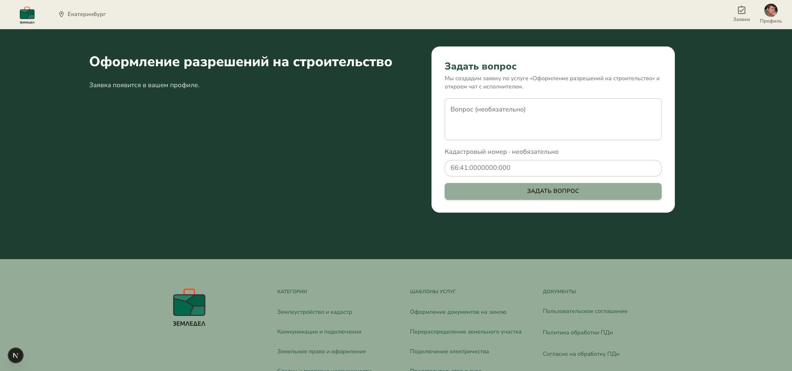
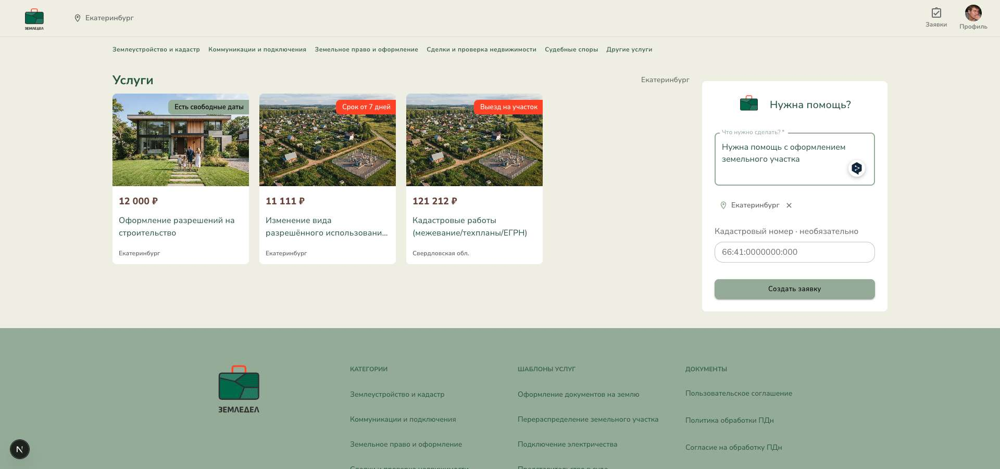
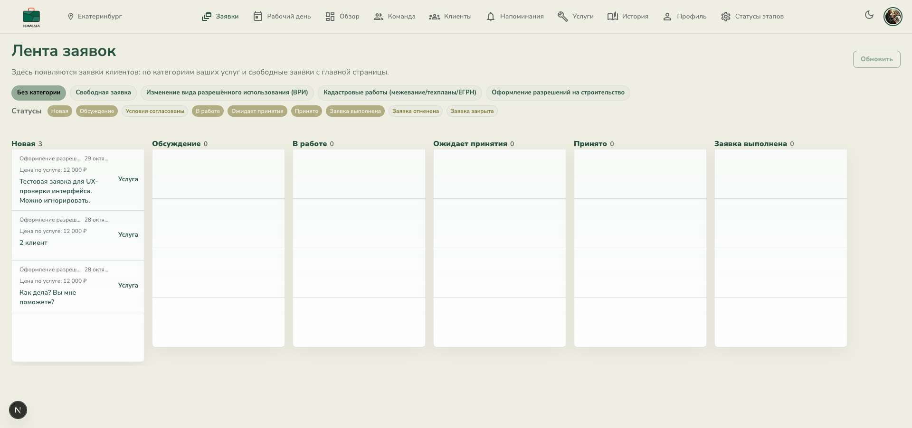
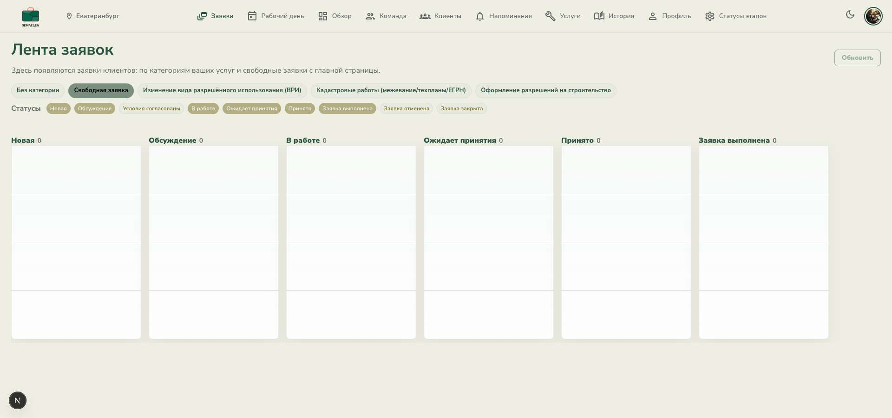
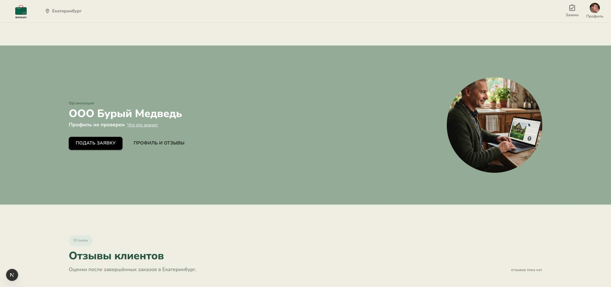

# UX audit: request workflow

Date: 2026-10-29
Surface: local Zemledel app in Chrome, customer and provider sessions.
Scope: service-card request and freeform “Нужна помощь?” request, plus the visible provider inbox and request workspace.

## Findings

### P1 — Service requests still require the customer to choose the already known provider

Evidence: [01 customer service request](./01-customer-service-request.jpg), [02 provider service request](./02-provider-service-request.jpg).

The service request detail shows “Чаты с компаниями”, asks the customer to choose a company, and presents “Выбрать исполнителем” even though the request already has a provider. The provider-side detail also shows “Клиент общается с компаниями: 1”. These labels/actions belong to the multi-provider freeform flow. In code, service creation stores `providerId`, but does not set the request lock; the contract endpoint requires a lock. This makes the customer redundantly select the known provider before reaching contract.

Relevant code: `backend/src/requests/requests.service.ts` lines 636–647, 2416–2424, 2556–2559; `frontend/widgets/customer-requests/ui/CustomerRequestConversationWorkspace.tsx` lines 929–937 and 958–994; `frontend/widgets/request-lifecycle-actions/model/request-lifecycle-model.ts` lines 244–250.

### P2 — The service page has two request CTAs with different behavior

Evidence: [04 service detail](./04-service-detail.jpg), [09 provider CTA](./09-service-provider-cta.jpg), [05 service request form](./05-service-request-form.jpg).

“ОСТАВИТЬ ЗАЯВКУ” scrolls to the question form. “ПОДАТЬ ЗАЯВКУ” directly creates the request with an empty message and navigates to the request workspace. The labels sound like the same action, but one opens a form and the other submits immediately.

Relevant code: `frontend/features/create-service-request-lead/ui/ServiceQuickApplyButton.tsx` lines 22–25; `frontend/widgets/service-page/ui/ServiceLeadSection.tsx` lines 50–61.

### P2 — The service form promises a chat even when it does not create one

Evidence: [05 service request form](./05-service-request-form.jpg).

The form says it will create a request and open a chat; the “Вопрос” field is optional. When it is empty, submission skips chat creation. The customer then lands on a request page that asks them to press “Начать чат” as another step. This conflicts with the form’s promise and creates an unexpected extra step.

Relevant code: `frontend/widgets/service-page/ui/ServiceLeadSection.tsx` lines 53–56; `frontend/features/create-service-request-lead/model/useServiceAskQuestion.ts` lines 33–54; `frontend/widgets/customer-requests/ui/CustomerRequestConversationWorkspace.tsx` lines 155–191 and 941–951.

### P2 — The freeform form does not explain that multiple providers may respond

Evidence: [03 home/freeform entry](./03-home-freeform-entry.jpg), [06 filled freeform form](./06-freeform-filled.jpg).

The “Нужна помощь?” form asks what needs doing, location, and an optional cadastral number, then says “Создать заявку”. It does not set expectations that this request is published to multiple providers and that the customer will compare replies, chat, then choose one. That makes the important difference from a service-card request invisible at the decision point.

### P2 — The provider’s empty freeform filter looks like a blank board, not an empty state

Evidence: [08 provider freeform filter](./08-provider-freeform-filter-empty.jpg).

With the “Свободная заявка” filter selected and all counts at zero, the board shows several blank card-like areas without a message such as “Пока нет свободных заявок”. It can read as loading or missing content.

### P2 — The customer sees “Новая” after sending the first service message, without a clear waiting state

Evidence: [01 customer service request](./01-customer-service-request.jpg), [02 provider service request](./02-provider-service-request.jpg).

The customer’s message is visible in chat, but the request still says “Новая” and the “Обсуждение” step is inactive. The provider inbox also groups it under “Новая”. The code intentionally keeps a service request in `NEW` until the provider replies, but the customer screen does not say “Ждём ответа исполнителя”. The customer may read the unchanged stage as a message or request that was not delivered.

Relevant code: `backend/src/chat/chat.service.ts` lines 1196–1207.

## Steps and health

1. Home: choose a service or “Нужна помощь?” — **Needs clarity**; freeform outcome is not explained. Screenshot 03.
2. Service detail: start a request — **Inconsistent**; similar CTAs take different paths. Screenshots 04, 05, 09.
3. Service request: open the chat — **Broken for this request type**; freeform provider-selection UI appears, and the form’s chat promise depends on a non-empty question. Screenshot 01.
4. Provider inbox: receive the request — **Usable, with status ambiguity**; the provider sees it as new until replying. Screenshot 07.
5. Provider reply and customer comparison — **Not fully verified**; no freeform request with multiple replies was available in this account, and I did not create one.
6. Customer selects a provider — **Not exercised**; the action locks assignment and rejects other providers.
7. Contract, work, acceptance, completion — **Not exercised**; these steps alter the request and would require changing real local test data.

## Limits

Screenshots were captured from the current Chrome sessions. I inspected only existing requests and did not submit a new request, send a message, assign a provider, send a contract, or change work status. The browser approval review previously rejected the “Выбрать исполнителем” action because it changes and locks request assignment; I stopped there. Multi-provider comparison and post-selection work states therefore need a separate test run with disposable test data. Screenshot review does not establish full accessibility compliance.

No application code or design was changed. The report and screenshots are saved in this folder.

## Screenshots

### 01 — Customer service request

### 02 — Provider service request

### 03 — Home and freeform entry

### 04 — Service detail

### 05 — Service request form

### 06 — Filled freeform form, not submitted

### 07 — Provider inbox

### 08 — Empty freeform filter

### 09 — Provider section CTA

