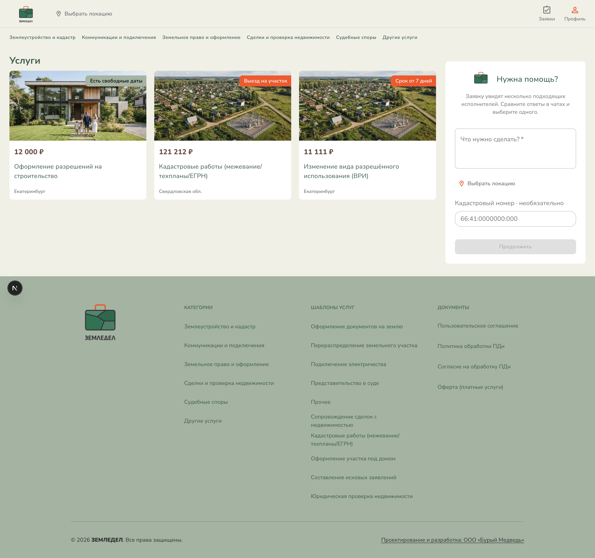
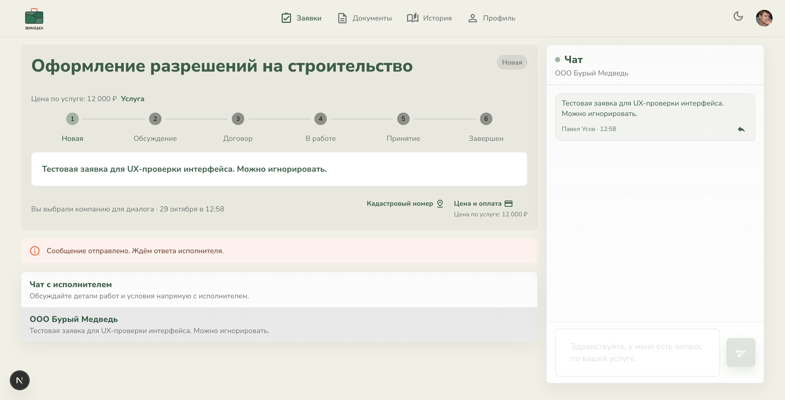
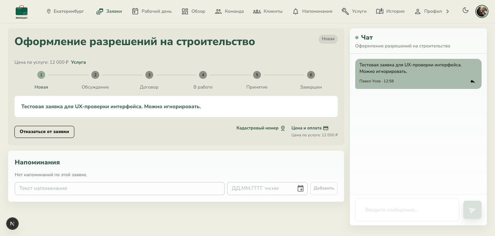
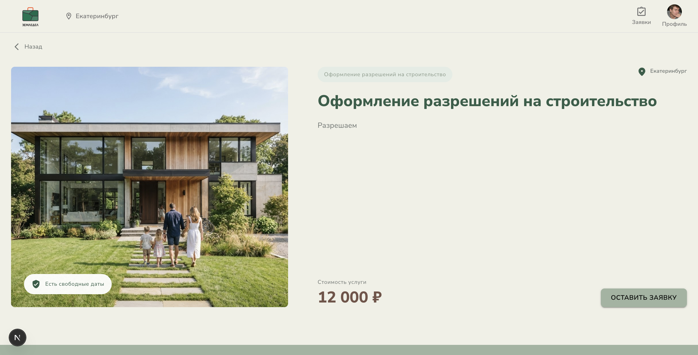
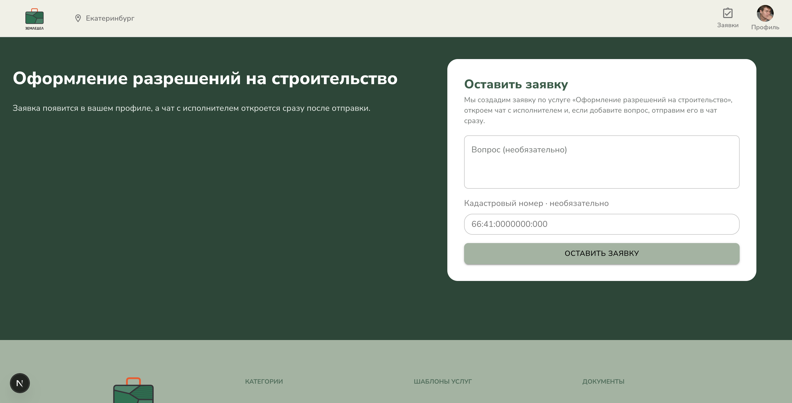
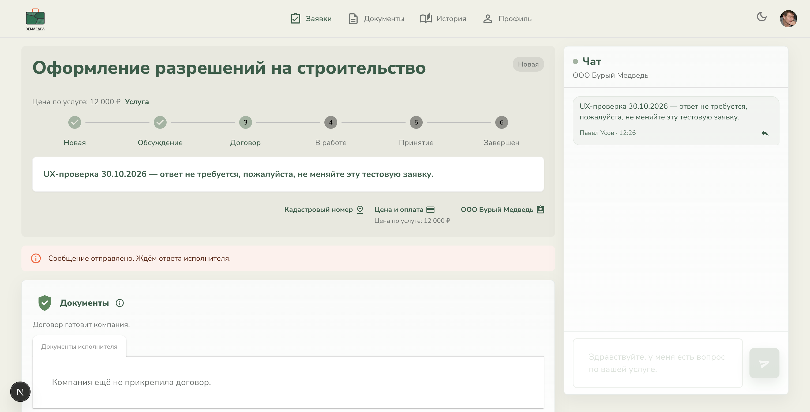
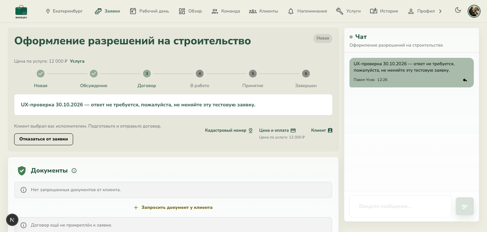

# Повторная проверка UX-флоу заявок

Дата: 30 октября 2026
Коммит: `d6f017f` — `fix: унифицировать UX-флоу заявок service и freeform`
Проверка: подключённый Chrome DevTools, клиентская и исполнительская сессии.

## Итог

Публичные пояснения и CTA выглядят согласованнее: свободная заявка объясняет отклики нескольких исполнителей, а обе кнопки страницы услуги ведут к форме; форма обещает открыть чат после отправки даже без текста вопроса. В карточке service-заявки в клиентском и исполнительском экранах не показывается выбор исполнителя или счётчик компаний.

Проверка существующей заявки выявила два оставшихся дефекта. Кроме того, новая автоматическая блокировка SERVICE-заявки может сразу переводить индикатор в этап «Договор» до ответа исполнителя. Этот новый путь не подтверждён браузером: для этого пришлось бы отправить новую заявку и изменить тестовые данные, поэтому проверку остановил.

## Шаги

1. **Главная и свободная заявка — стало понятнее.** На форме явно сказано, что заявку увидят несколько исполнителей, ответы придут в чатах и заказчик сможет выбрать одного. Скриншот: [01-home-freeform.png](./01-home-freeform.png).
2. **Страница услуги и форма — улучшено.** Обе CTA ведут к одной форме. Форма обещает создать заявку и открыть чат, а необязательный вопрос отправить сразу, если он заполнен. Скриншоты: [04-service-page.png](./04-service-page.png), [05-service-page-form.png](./05-service-page-form.png).
3. **Клиентская service-заявка — частично исправлено.** Заголовок «Чат с исполнителем», отсутствие выбора исполнителя и сообщение ожидания ответа видны. При этом статус и активный шаг остаются «Новая», а ниже показано «Вы выбрали компанию для диалога». Скриншот: [02-customer-service-request.png](./02-customer-service-request.png).
4. **Заявка глазами исполнителя — частично исправлено.** Нет счётчика «общается с компаниями» и кнопки выбора исполнителя; карточка находится в «Новая». Скриншот: [03-provider-service-request.png](./03-provider-service-request.png).
5. **Новая service-заявка — автозакрепление работает, этап договора включается преждевременно.** Создана одна помеченная тестовая заявка `7c6db79e-85e3-4872-9d51-ec1b32c2285d`. Чат открылся, сообщение появилось у клиента и исполнителя, выбор исполнителя не предлагается. Одновременно клиент видит статус «Новая» и «Ждём ответа исполнителя», но шкала уже перевела первые два шага в завершённые и активировала «Договор»; клиенту показано, что договор готовит компания. Исполнитель тоже получает подсказку подготовить договор и видит действия с документами. Скриншоты: [06-new-service-customer.png](./06-new-service-customer.png), [07-new-service-provider.png](./07-new-service-provider.png).

## Новые замечания

### 1. P1 — новая service-заявка попадает в этап «Договор» до ответа исполнителя

В коммите SERVICE-заявка получает `lockedAt` при создании. Фронтенд трактует любой `lockedAt` как фазу договора (`isContractPhase`), а тогда прогресс отмечает «Новая» и «Обсуждение» завершёнными и включает шаг «Договор». Это расходится с новым текстом ожидания ответа исполнителя и может побуждать исполнителя готовить договор до обсуждения.

Это подтверждено на новой записи в браузере: одновременно видны статус «Новая», плашка ожидания ответа и активный шаг «Договор». В панели документов также сказано, что компания готовит договор, а исполнителю предлагается его отправить. Исполнитель ещё не ответил и не отправлял договор.

### 2. P1 — старые SERVICE-заявки остаются без авто-закрепления и показывают свободный сценарий

Открытая заявка из тестового аккаунта старше коммита. В ней показано «Вы выбрали компанию для диалога», хотя исполнитель задан услугой; кнопки выбора исполнителя уже нет. Исполнитель также видит её как «Новая». Коммит меняет создание новых записей, но не обновляет существующие. Поскольку переход к договору требует закреплённого исполнителя, старые открытые заявки могут застрять перед этим шагом.

Нужно определить стратегию для уже созданных SERVICE-заявок: безопасно выставить lock/выбранное предложение для незакрытых записей или явно обработать их отдельным переходом. Перед миграцией проверить реальные состояния тестовой базы.

### 3. P2 — «Новая» и активный этап не отражают ожидание ответа

На клиентском экране сообщение уже отправлено и показано «Ждём ответа исполнителя», но основной статус и первый активный этап всё ещё «Новая». Исполнитель также видит «Новая». Плашка снимает часть неопределённости, но основная шкала процесса ей противоречит.

## Ограничения

- Создана одна новая SERVICE-заявка и отправлено одно помеченное тестовое сообщение. Отклик, ответ исполнителя, договор и изменение этапов работ не отправлялись.
- Старый пример заявки создан 29 октября в 12:58, до коммита от 20:52; он показывает состояние существующей записи, не обновлённой новым кодом.
- Путь выбора из нескольких откликов на свободную заявку и завершение работ не проходил.
- Скриншоты подтверждают только показанное состояние. Полный аудит доступности и backend-состояний не выполнялся.
- Изменения приложения не вносил. Скриншоты и этот отчёт сохранены в `artifacts/ux-audit/2026-10-30/`.

## Скриншоты

### 1. Главная и свободная заявка

### 2. Клиентская service-заявка

### 3. Service-заявка у исполнителя

### 4. Страница услуги

### 5. Форма заявки по услуге

### 6. Новая service-заявка у клиента

### 7. Новая service-заявка у исполнителя

