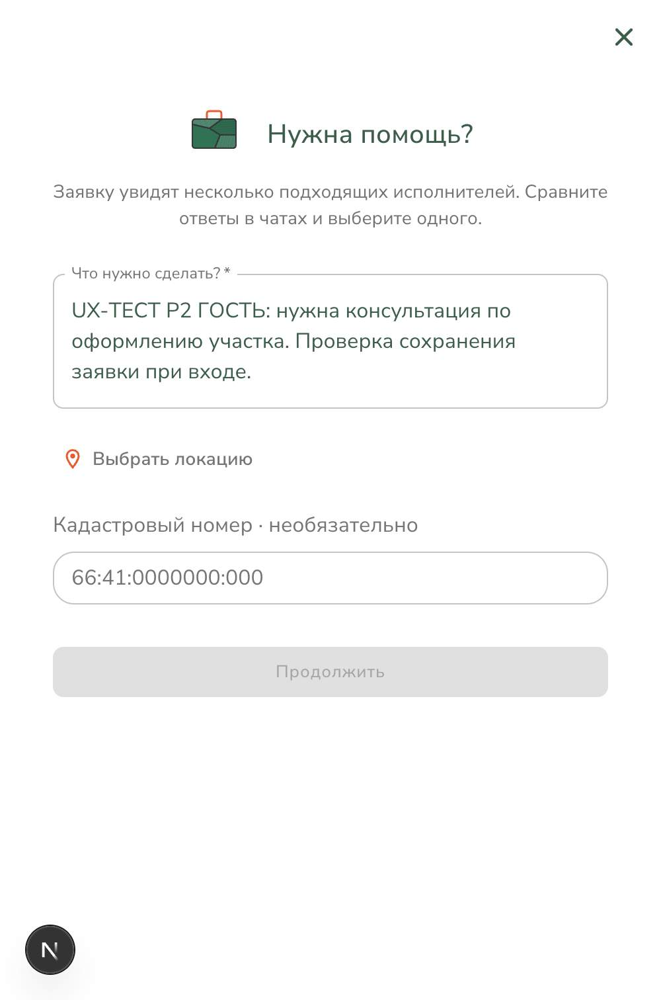
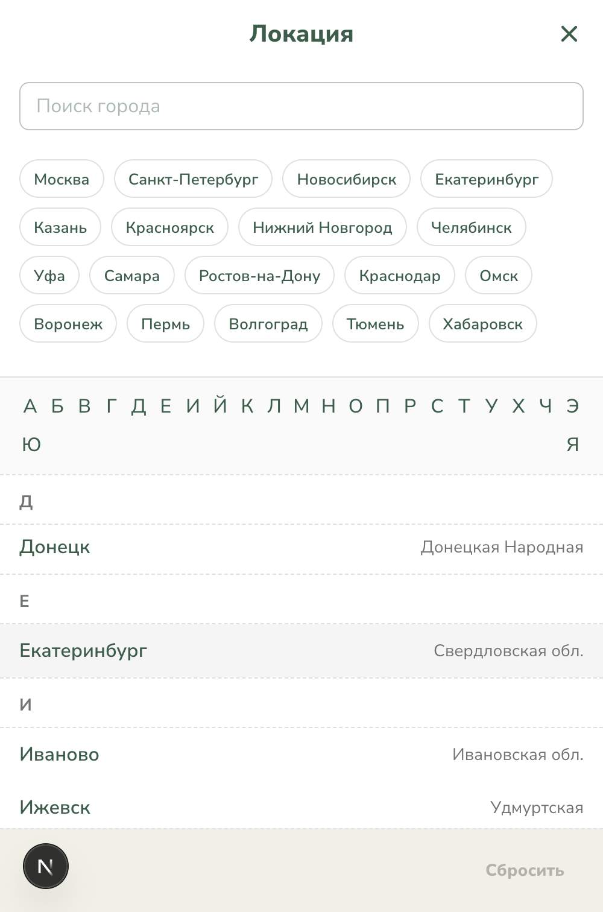
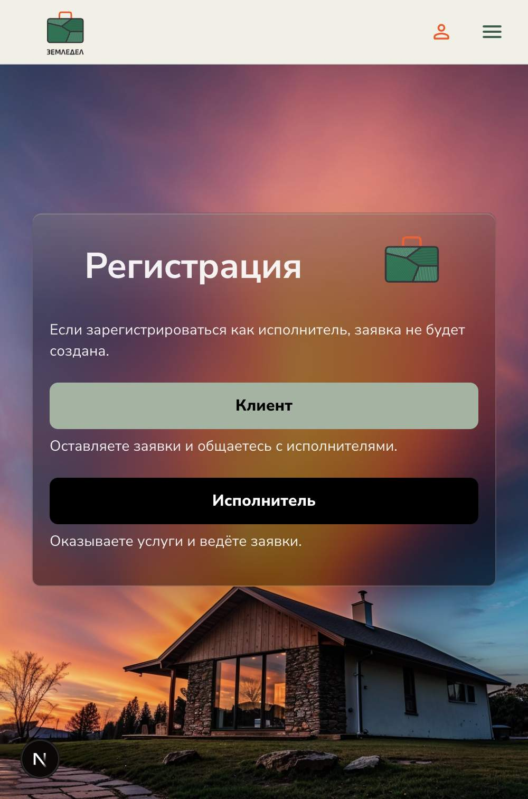
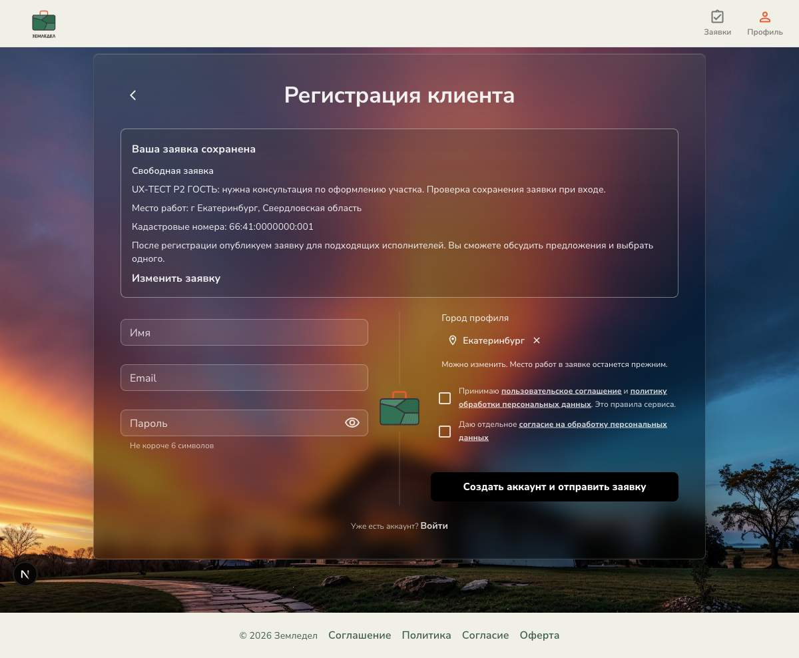
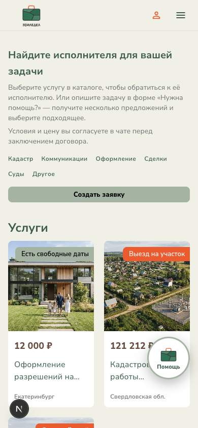
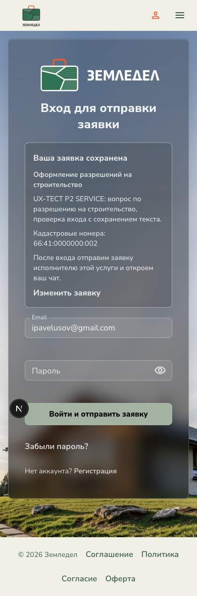
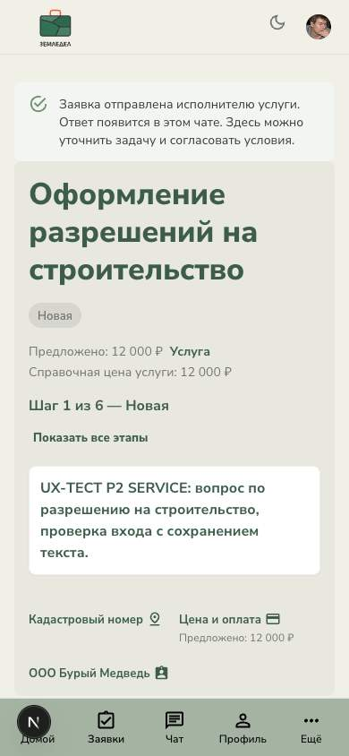
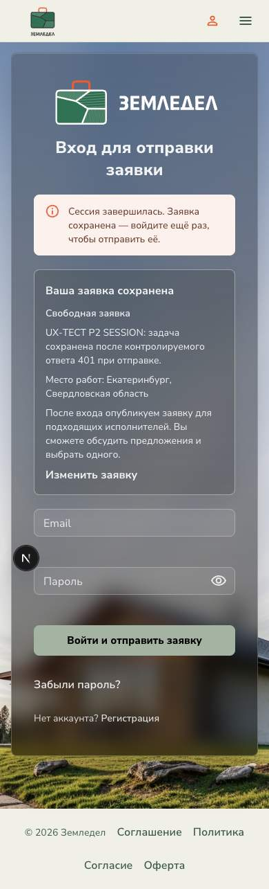
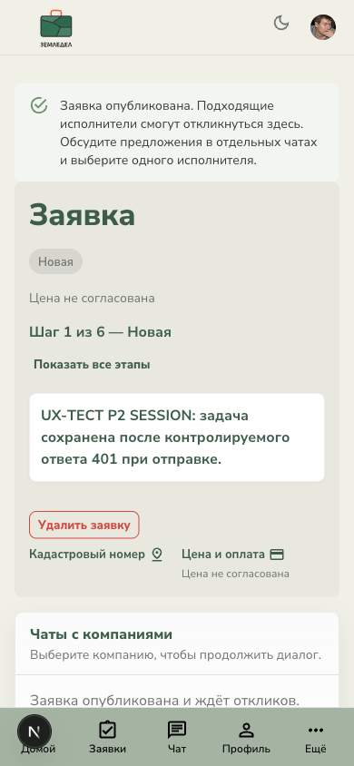
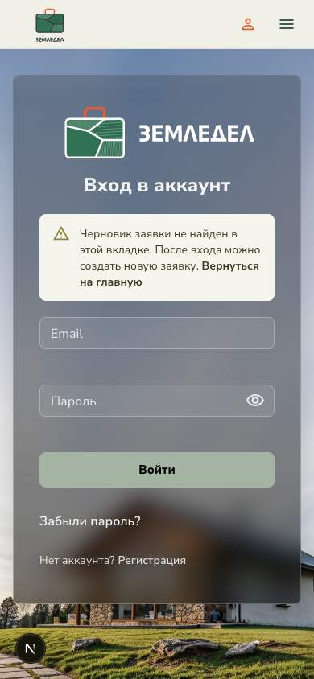

# P2 · Гость → вход/регистрация → созданная заявка

Проверка и исправления 01.11.2026 на `http://localhost:4000`. Браузер — Chrome DevTools MCP, отдельная временная сессия гостя; desktop 1200 px и мобильная эмуляция 390 px. Существующие три сессии клиента и исполнителей сохранены. Временная вкладка после проверки закрыта.

## Подтверждённые проблемы и исправления

1. **Выбор города был недоступен из формы на главной.** Родительский полноэкранный Dialog имел `z-index: 1500`, а окно города открывалось ниже него. В DOM присутствовал диалог города, но на скриншоте оставалась форма заявки. Убран повышенный слой родителя; выбор города проверен реальными кликами. Диалог формы получил доступное имя.
2. **После заявки требовалось повторно выбирать роль.** Путь с `intent=service-request` теперь сразу открывает регистрацию клиента. Обычная регистрация без заявки сохраняет выбор роли.
3. **На входе и регистрации исчезал видимый контекст задачи.** Добавлен блок сохранённой заявки: услуга/категория, описание, место работ и кадастровые номера. Показано, что произойдёт после авторизации; ссылка возвращает к редактированию с восстановленными полями. В SERVICE сохраняется и подставляется введённый email. Ссылка на вход доступна в начале регистрации.
4. **Город приходилось выбирать заново.** Сохранённый город работ подставляется в город профиля нового клиента. Поля явно разделены: изменение города профиля не переписывает место работ заявки.
5. **После создания FREEFORM авторизованный пользователь попадал в общий список.** Теперь открывается конкретная заявка с подтверждением публикации и объяснением ожидания откликов. SERVICE получает подтверждение обращения к одному известному исполнителю.
6. **Отправка зависела от жизненного цикла React-компонента.** Продолжение заявки вынесено в общий модуль: параллельные вызовы используют одну отправку; полученный ID сохраняется до перехода. Ошибка последующего открытия чата не приводит к повторному созданию заявки. Поздний ответ не заменяет новый отредактированный черновик.
7. **Истечение сессии могло оставить только ошибку отправки.** При 401 сохраняются введённые данные, открывается повторный вход и отключается автоматический возврат по устаревшей клиентской сессии. Пустой черновик явно объясняется; обещание автоматической отправки в этом случае не показывается.

На главной добавлено краткое объяснение двух путей обращения. В гостевой SERVICE-форме формулировка «Получить консультацию» заменена на «Оставить заявку», кнопка до авторизации — «Продолжить».

## Браузерный проход

| Шаг | Сценарий | Результат |
|---|---|---|
| 1 | Гость открывает главную и форму «Нужна помощь?» | Успешно; два пути обращения объяснены, окно города теперь доступно |
| 2 | FREEFORM: описание + Екатеринбург + тестовый кадастровый номер → регистрация | Успешно; роль клиента выбрана автоматически, черновик виден |
| 3 | Возврат к редактированию и повторное продолжение | Успешно; описание и кадастровый номер восстановлены, локация нового черновика сохранена |
| 4 | Регистрация нового тестового клиента; город профиля изменён на Тюмень | Успешно; сразу открылась новая FREEFORM, место работ осталось Екатеринбургом; в аккаунте ровно одна заявка |
| 5 | SERVICE: описание + email + кадастровый номер → переход с регистрации на вход | Успешно; название услуги, текст, email и номер сохранились |
| 6 | Вход существующим клиентом | Успешно; открылась конкретная SERVICE-заявка, назначен один исполнитель, создан один чат и одно начальное сообщение |
| 7 | Контролируемый 401 при отправке из авторизованной формы | Успешно; черновик сохранился, показан повторный вход без цикла переходов |
| 8 | Повторный вход после 401 | Успешно; создана ровно одна FREEFORM с исходным текстом и городом, черновик очищен |
| 9 | Вход по ссылке продолжения без черновика | Успешно; понятное предупреждение и переход на главную, обычная кнопка «Войти» |

## Тестовые данные

- Новый локальный клиент: `ux-guest-20261101-2031@example.com`, имя «UX Тест Гость», город профиля Тюмень. Пароль в отчёт не записывается.
- FREEFORM после регистрации: `9ad570f6-23ab-4c30-a7b9-4b346cce4950`, Екатеринбург, `66:41:0000000:001`.
- SERVICE после входа: `87756c53-8e96-47b1-bf16-37ef96573c24`, услуга «Оформление разрешений на строительство», `66:41:0000000:002`.
- FREEFORM после восстановления сессии: `ed64beb7-3c9e-40f2-b00e-c93b569da56a`, Екатеринбург.
- Для теста сессии браузер получил один искусственный ответ 401 только на POST создания заявки. После перехвата обычный `fetch` был восстановлен. Реальное истечение JWT по таймеру не ожидалось.

## Проверки кода

- Профильные Vitest: **21/21**, восемь файлов — сохранение/продолжение, защита от повторной отправки, возврат к SERVICE-форме, истечение сессии в обоих типах формы, маршрутизация, регистрационная валидация.
- Frontend `npm run build` — успешно.
- Frontend `npm run lint` — 0 ошибок, 4 предупреждения вне изменённого кода.
- `git diff --check` — успешно.
- Отдельный общий `tsc --noEmit` не проходит: он включает тестовые файлы и сообщает о разрешении `vitest.d.ts` как модуля и других ошибках тестовых типов. Прикладная Next.js-сборка и выполняемые Vitest-наборы проходят. Полные suites в этой задаче не запускались.

## Границы

Проверены действия мышью, поля, переходы, DOM и скриншоты. Доставка email, реальная мобильная клавиатура, экранный диктор и полный клавиатурный проход не проверялись. Хранение черновика ограничено текущей вкладкой браузера; отсутствие черновика в другой вкладке объясняется интерфейсом. Серверная идемпотентность при потере успешного ответа на POST остаётся отдельной задачей: текущая защита покрывает повторные вызовы в браузере и сохранённый ID полученной заявки.

## Скриншоты

### До исправлений: выбор города скрыт под формой

### После исправления: город доступен для выбора

### До исправлений: лишний выбор роли

### После исправлений: сохранённая задача и город профиля

### Первый экран гостя на мобильной ширине

### Вход существующего клиента с сохранённой SERVICE-заявкой

### Созданная SERVICE-заявка

### Истечение сессии и успешное восстановление

### Отсутствующий черновик

