# Продолжение UX-аудита, 01.11.2026

> Актуальное состояние: обе тестовые заявки завершены. FREEFORM проверена с замечаниями и повторной сдачей; SERVICE — с публикацией и завершением этапа. Ниже сохранена история проходов; прежние блокеры загрузки сняты ручной загрузкой пользователя. Последние результаты — в разделе «Завершение SERVICE».

Проверка через Chrome DevTools MCP. Использованы прежние тестовые SERVICE `e7a81715-5c9f-449e-95b1-4925142dbe1d` и FREEFORM `2e445587-6d26-4b78-a907-67046568c214`. Второй исполнитель — ИП Медведев И. П. Код приложения не изменялся.

## Пройденные шаги

1. Второй исполнитель открыл свободную заявку после отказа первой компании — успешно. Чат изначально пуст, переписка первой компании в нём не показана.
2. Второй исполнитель отправил предложение 9000 ₽ / 5 дней — успешно. Клиент увидел две строки компаний и смог переключать независимые переписки.
3. Клиент отправил сообщение только ИП Медведеву — успешно. В переписке ООО «Бурый Медведь» это сообщение не отображается. Это проверка UI-разделения, не полный аудит доступа к API.
4. Клиент выбрал ИП Медведева, находясь в чате прежней компании — выбор успешен, но чат не переключился.
5. Прежний исполнитель открыл заявку после выбора другого — видит режим просмотра, документы и финансовые действия скрыты. В чате появляется техническая ошибка `Request is locked`.
6. Клиент попробовал отправить тестовое сообщение в оставшийся открытым старый чат — UI позволил набрать и отправить, сервер отказал `Forbidden`, появилась кнопка «Повторить».
7. Загрузка предоставленного PDF и подписи — заблокирована инструментом до передачи файлов приложению: `Access denied ... is not within any of the configured workspace roots`. Оба файла существуют, но Chrome DevTools MCP не разрешает загрузку из Downloads. В SERVICE и FREEFORM открыты диалоги загрузки, ожидается ручная загрузка пользователем.
8. Согласование договора, работа, замечания, приёмка и завершение — ещё не пройдены. Наличие файлов у агента не означает успешную передачу в браузер.

## Новые подтверждённые недостатки

### P1 — После выбора компании остаётся чат другого исполнителя

На экране подтверждено «Вы выбрали ИП Медведев И. П.», но справа открыто ООО «Бурый Медведь». Поле ввода доступно. Попытка отправить сообщение заканчивается `Forbidden` и предлагает «Повторить», хотя повтор не устраняет причину.

Рекомендация: после успешного выбора активировать диалог выбранного исполнителя. Старые чаты переводить в явный архивный режим с пояснением и без поля отправки. При серверном запрете показывать понятную причину и действие «Перейти к выбранному исполнителю».

Кодовая привязка: `frontend/widgets/customer-requests/ui/CustomerRequestConversationWorkspace.tsx`, функция `selectProvider` обновляет заявку и notice, но не `selectedConversationId`.

### P2 — Штатное ограничение выглядит как техническая ошибка

Прежний исполнитель получает корректное пояснение «Клиент выбрал другого исполнителя. Переписка сохранена для просмотра», но одновременно красную ошибку `Request is locked`. Клиент при попытке писать в старый чат видит английское `Forbidden`.

Рекомендация: отображать ожидаемое состояние архива без аварийной ошибки, локализовать сообщения и синхронизировать доступность действий с серверными правилами.

### P2 — Цена прежнего предложения переносится к новому исполнителю

ИП Медведев предложил 9000 ₽, но до и после выбора общая цена остаётся 12000 ₽, сохранённая ранее клиентом при работе с первой компанией. Новая компания видит её тоже. Это подтверждает риск из UX-06 предыдущего отчёта. Автоматически извлекать цену из чата не требуется: необходим отдельный явный шаг согласования цены новой сделки или пометка «Требует пересогласования».

## Что работает

- Свободная заявка доступна второй организации без опубликованной собственной услуги.
- Клиент видит две компании и переключает переписки.
- В проверенных UI-экранах переписка с одной компанией не показывается другой.
- Выбор нового исполнителя после отказа предыдущего работает.
- Прежнему исполнителю после выбора другого ограничены действия. Не проверена автоматическая рассылка отказа двум одновременно активным кандидатам: первая компания уже отказалась в предыдущем проходе.

## Ограничения и состояние

FREEFORM теперь закреплена за ИП Медведевым, цена 12000 ₽ не менялась. SERVICE по-прежнему закреплена за ООО «Бурый Медведь». Отправлены только тестовые сообщения; попытка сообщения прежнему исполнителю отклонена. Документы не загружены, договоры не приняты, работы и платежи не завершались.

Пользователь предоставил PDF и подпись; блокер теперь относится к разрешённым файловым каталогам MCP, а не к отсутствию документов. Не предпринимался обход ограничения через другие каналы загрузки. Для продолжения нужно вручную загрузить комплект в оба открытых диалога либо настроить разрешённый каталог MCP.

## Скриншоты

Каждый снимок сохранён и визуально просмотрен.

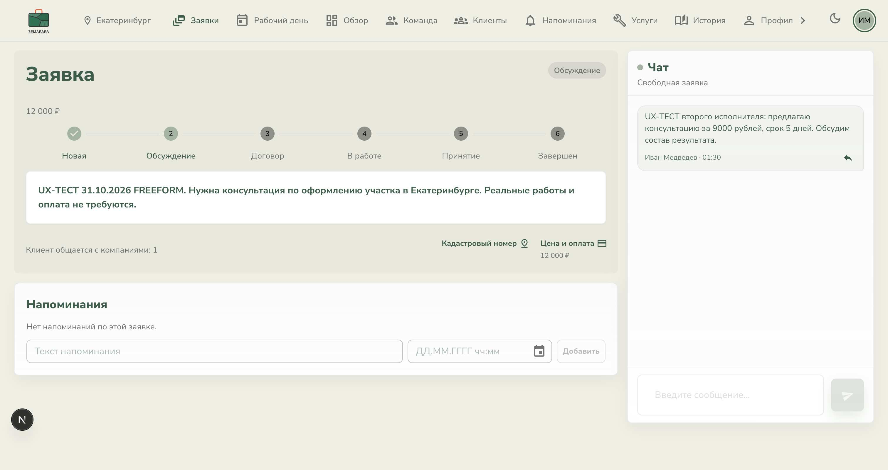

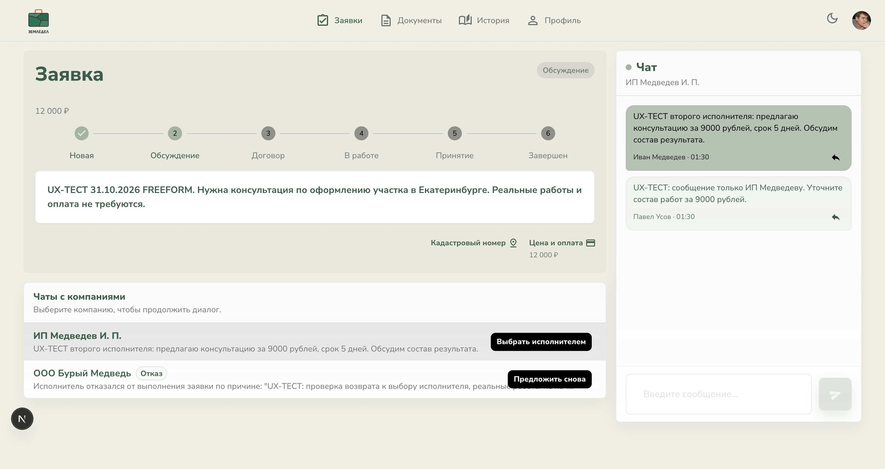

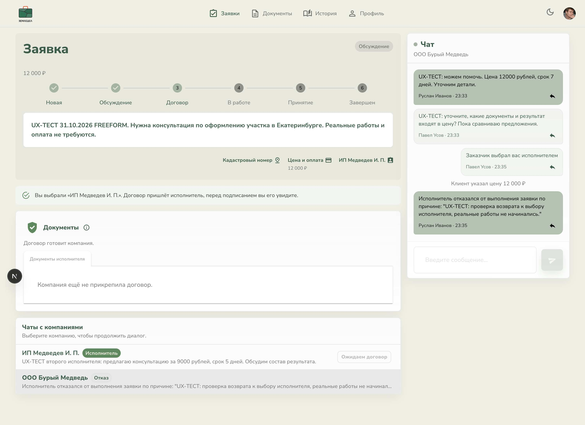

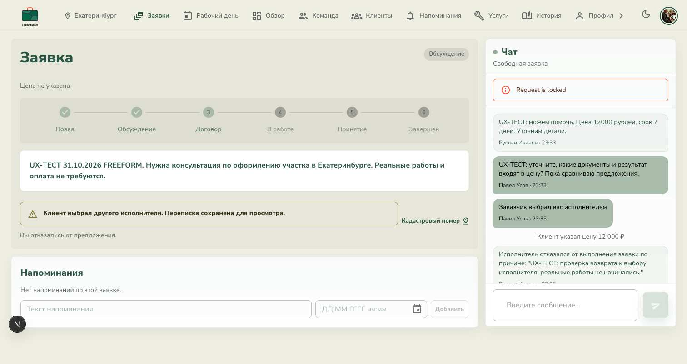

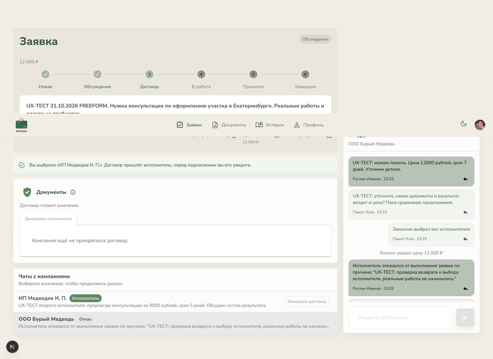

Текст ошибки `Forbidden` и кнопка «Повторить» подтверждены accessibility-снимком браузера. На полном скриншоте они перекрыты нижней областью чата.

## После загрузки договора

Проверка продолжена через Chrome DevTools MCP в той же тестовой FREEFORM-заявке. Пользователь загрузил комплект в свободную заявку ИП Медведева, а не в SERVICE под ООО «Бурый Медведь».

### Шаги и состояние

1. **Загрузка договора — успешно.** У исполнителя видны PDF, подпись и статус ожидания решения. На уже открытой странице клиента договор не появился до обновления.
2. **Одобрение — успешно после обновления страницы.** У клиента есть скачивание, одобрение и возврат на доработку. Проверен положительный путь; возврат самого договора не выполнялся.
3. **Подписание — успешно.** После одобрения появляется отдельный шаг с ценой 12000 ₽ и флажком согласия. Заявка автоматически становится «В работе». У исполнителя потребовалось обновление страницы для отображения состояния.
4. **Сдача — проходит, но без предъявленного результата.** Не создавались этапы, описание выполненной работы или вложения результата. После подтверждения «Услуга выполнена» начался срок приёмки до 08 ноября 01:36.
5. **Замечания — успешно.** Клиент отправил тестовое замечание об отсутствии результата. Подтверждение объясняет возврат в работу и новый семидневный срок после повторной сдачи. Заявка вернулась в работу, сдача заблокирована с понятной причиной.
6. **Устранение и повторная сдача — успешно.** Исполнитель отметил замечание выполненным; комментарий об исправлении не запрашивался. Сдача снова доступна. После повторной сдачи клиент увидел новый срок 08 ноября 01:38.
7. **Приёмка клиентом — успешно.** Есть подтверждение необратимости и информация об остатке оплаты. После принятия статус «Принято», появляется форма отзыва. Отзыв не публиковался.
8. **Завершение исполнителем — успешно, выявлен риск расчётов.** Приложение предупреждает, что остаток 12000 ₽ не оплачен и после завершения нельзя отмечать оплаты, но позволяет завершить.
9. **Проверка после завершения — подтверждена с обеих сторон.** Статус «Заявка выполнена». В панели оплаты исполнителя остались «Оплат пока нет» и «К оплате 12000 ₽», кнопки отметки оплаты отсутствуют.
10. **SERVICE — заблокирован на загрузке.** Вкладка 9 с заявкой e7a81715… всё ещё содержит пустой диалог загрузки. Дальнейшие переходы этой заявки не тестировались.

### Приоритетные выводы

**P1 — Приёмка запускается без предъявленного результата (шаг 4, снимки 09–10).** Клиент видит «Проверьте результат», пустой прогресс и свёрнутые документы. Срок автоматического принятия уже идёт. Для услуги результат может быть передан вне сайта, поэтому обязательные файлы для всех услуг не нужны. Но перед сдачей нужен обязательный краткий итог: что выполнено, где и когда передан результат, ссылки/файлы при наличии. Этот итог должен отображаться рядом с действиями приёмки.

**P1 — Завершение блокирует фиксацию оставшейся оплаты (шаги 8–9, снимки 13–14).** Предупреждение есть, однако нормальный сценарий «работы завершены, деньги поступили позднее» не поддержан видимым интерфейсом. Разделить завершение работ и расчётов; разрешить подтверждение поступления после завершения либо дать явный отдельный статус ожидания оплаты. Не требовать фиктивно отмечать оплату ради закрытия заявки.

**P2 — Обновление между ролями требует перезагрузки (шаги 1–3).** Пользователь загрузил договор, но у клиента оставалось «Компания ещё не прикрепила договор». После перезагрузки появились файлы и действия. После подписания открытая страница исполнителя продолжала показывать ожидание решения. Нужны актуализация состояния при возвращении во вкладку и событии изменения, либо заметное действие обновления. Не утверждается, что все переходы всегда требуют reload: часть проверок намеренно выполнялась с обновлением.

**P2 — Завершённая заявка содержит подсказки предыдущих стадий (шаги 7–9, снимки 12–14).** У исполнителя «Добавьте первый этап выполнения работ», хотя кнопки добавления уже нет. В оплате «Договоритесь о цене … зафиксируйте её здесь», хотя изменение недоступно. У клиента рядом с завершённой работой остаётся «Договор прикреплён». Нужны итоговые состояния без приглашений к недоступным действиям.

**P2 — Форма отзыва заранее выбирает пять звёзд (шаг 7, снимок 12).** Пользователь ещё не оценивал исполнителя, но максимальная оценка уже выбрана. Начинать с пустой оценки, отправлять только после явного выбора. Проверен интерфейс; публикация и её валидация не тестировались.

### Что работает и границы проверки

Есть понятные подтверждения подписания, сдачи, возврата и приёмки. Замечание действительно возвращает заявку в работу и блокирует сдачу, а не остаётся просто текстом в чате. После устранения доступна повторная приёмка. Оба участника видят финальное состояние после обновления.

В FREEFORM выполнены тестовые переходы до COMPLETED. Оплат нет, цена 12000 ₽ сохранена, одно тестовое замечание отмечено выполненным. Договор одобрен и принят в рамках теста. Реальные работы, платежи и отзывы не выполнялись. SERVICE не завершена. Не проверены: семь дней реального ожидания автоакцепта, уведомления вне сайта, исправление/перезагрузка договора, публикация этапов, массовые отклики, полная доступность с клавиатуры/скринридером и криптографическая корректность подписи. Предоставленный пользователем PDF использован как тестовый договор без правовой оценки содержания.

Визуальный риск доступности: вторичные действия светло-зелёным текстом выглядят малоконтрастными (снимок 07), но коэффициенты контраста не измерялись; соответствие WCAG не заявляется.

### Скриншоты продолжения

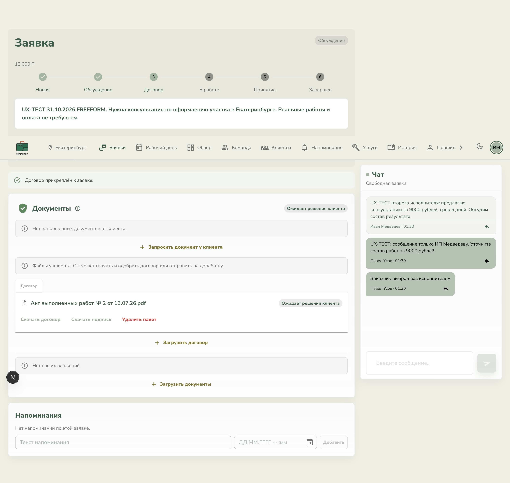

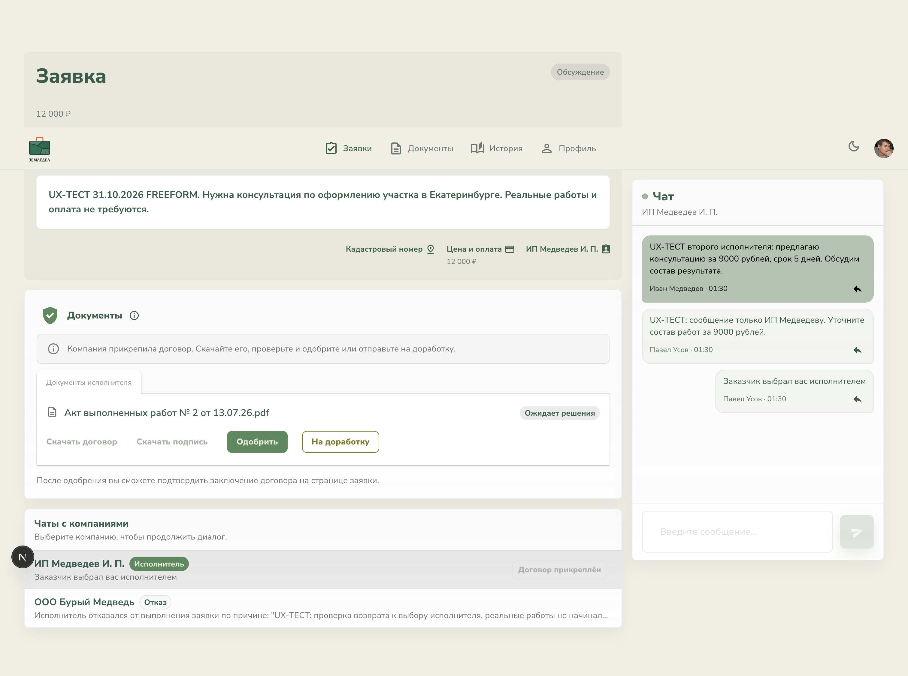

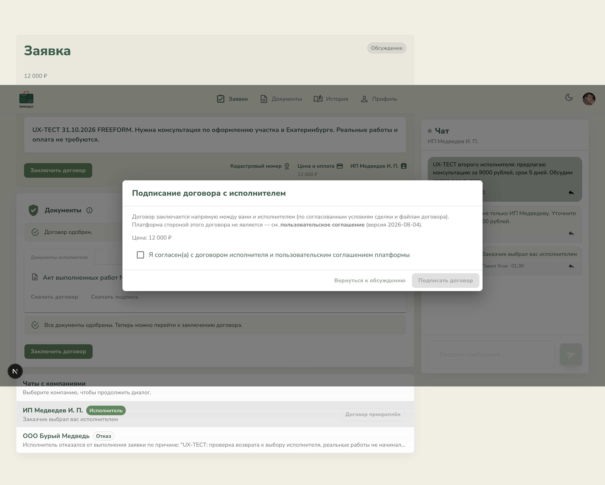

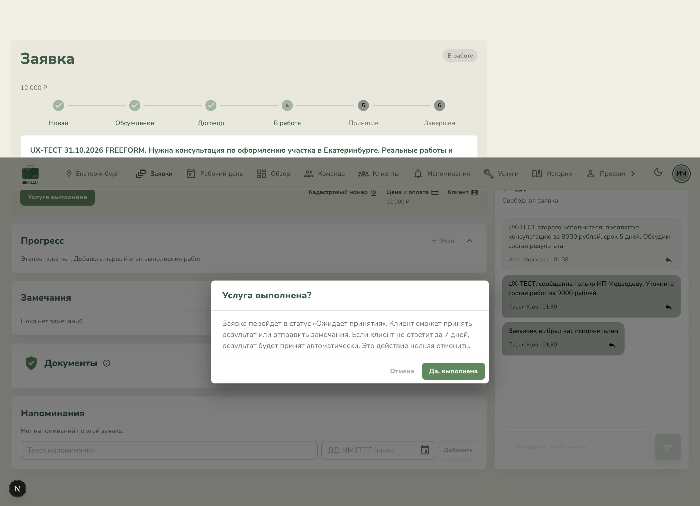

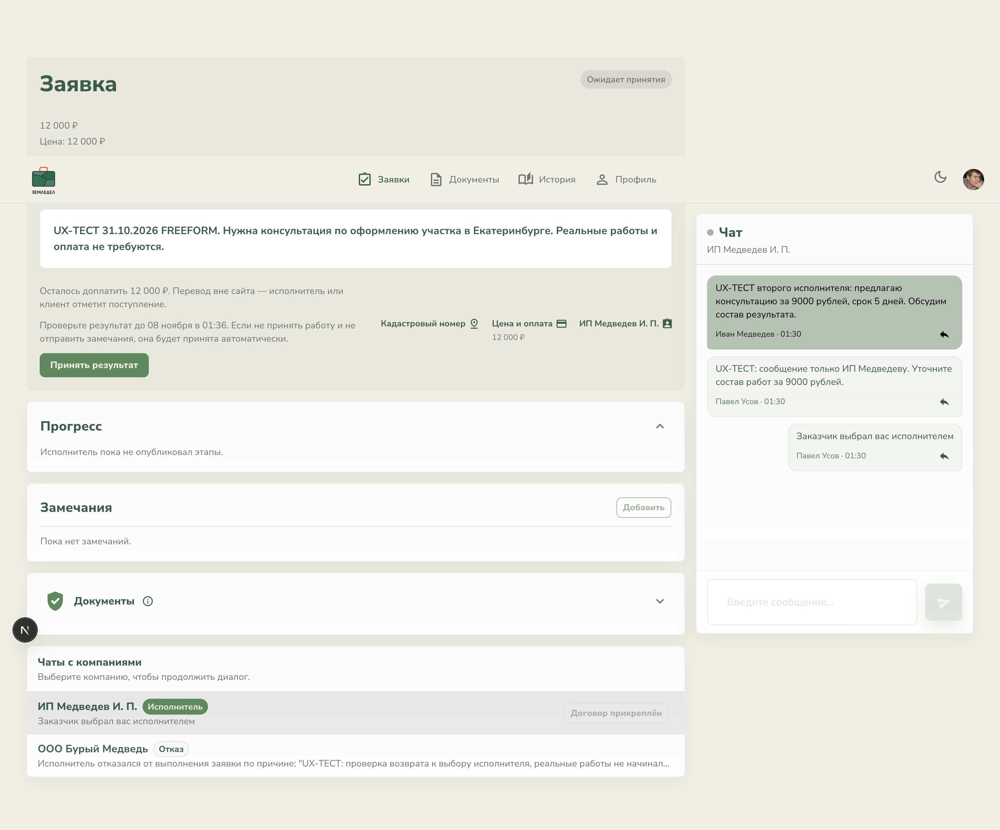

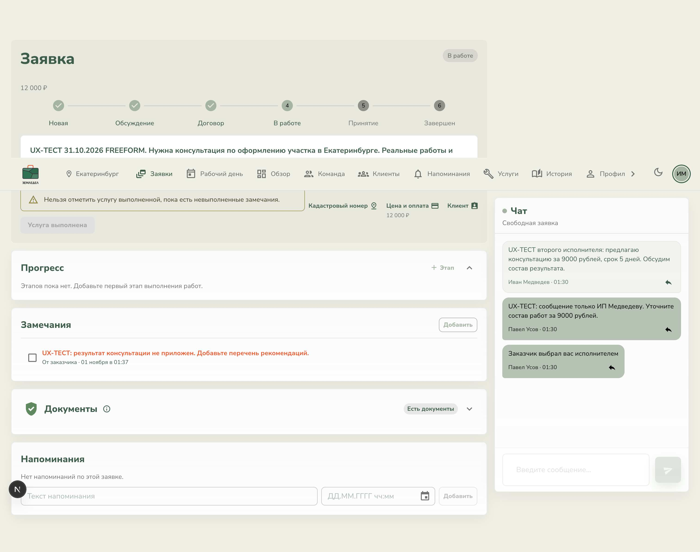

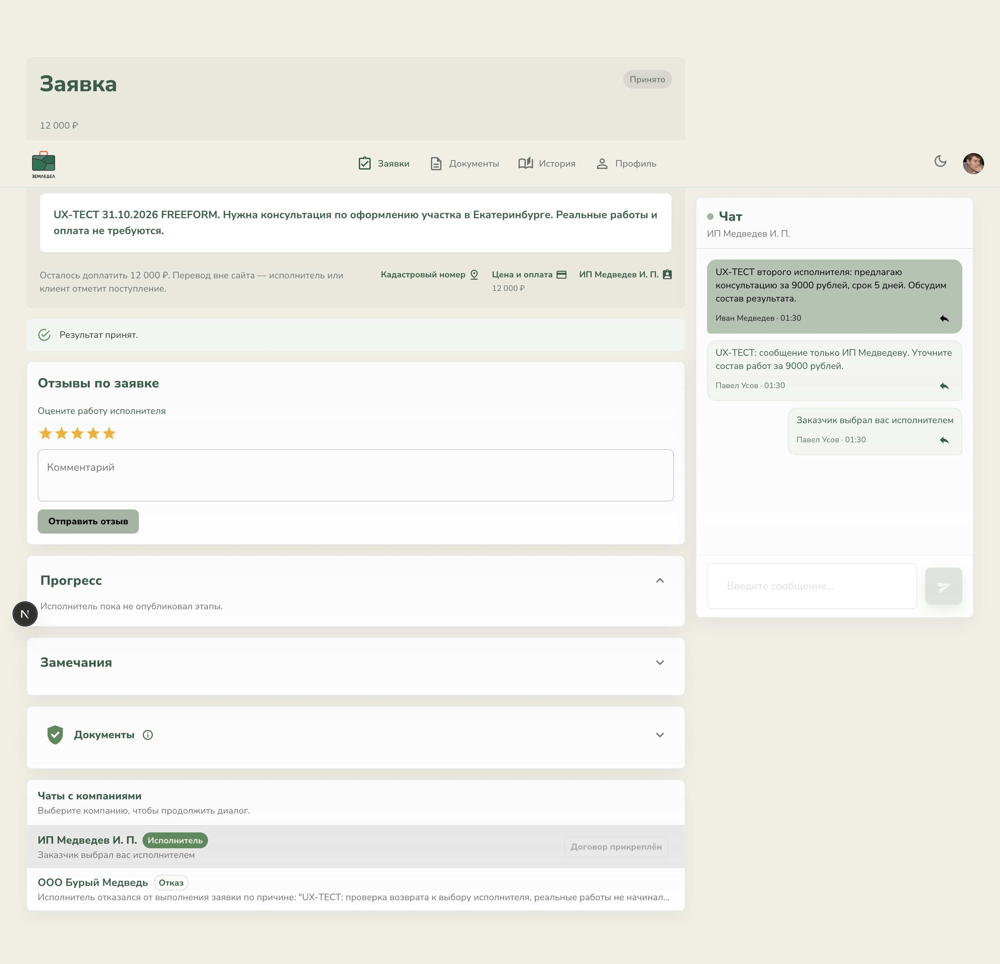

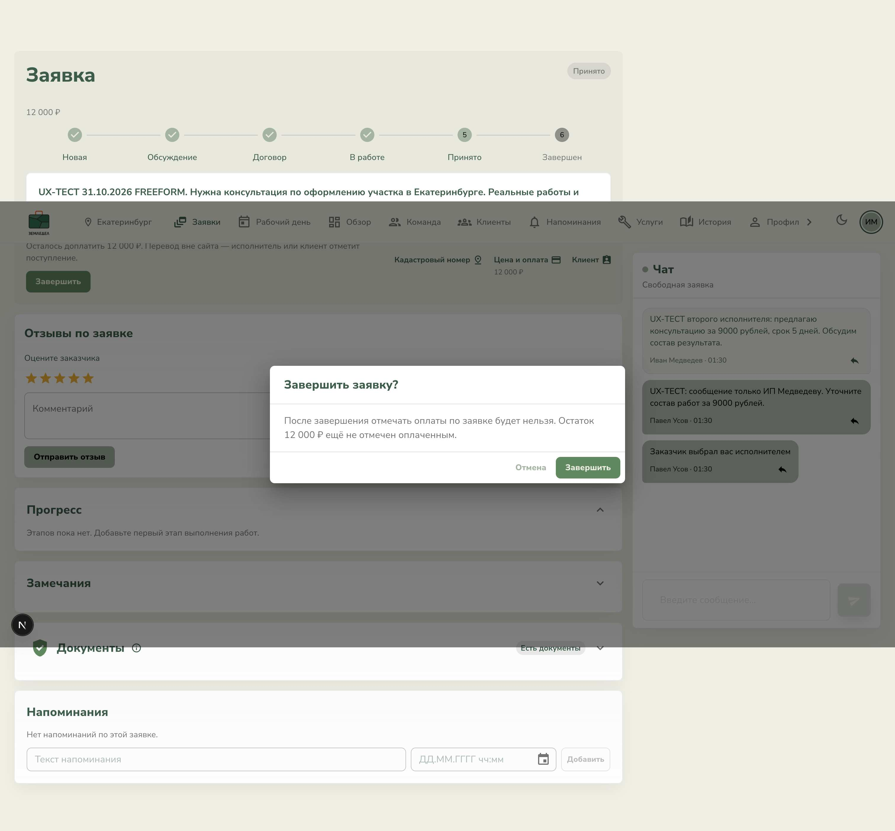

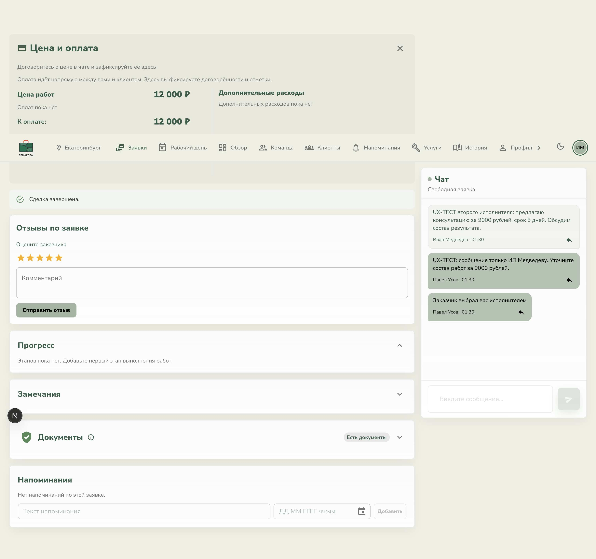

## Завершение SERVICE

После ручной загрузки пользователем PDF и подписи проверка продолжена через Chrome DevTools MCP под клиентом и ООО «Бурый Медведь».

### Шаги и состояние

1. **Проверка договора — успешно.** В клиентской вкладке комплект уже появился без ручной перезагрузки. Блок «Выбрать исполнителя» не показан: исполнитель известен из услуги.
2. **Одобрение и подписание — успешно.** Клиент одобрил договор и подтвердил подписание флажком. В подтверждении указана цена 12000 ₽. Заявка перешла в работу. Вкладка исполнителя обновлена вручную, поскольку при непосредственной проверке ещё показывала прежнее состояние.
3. **Публикация этапа — успешно.** Исполнитель создал «UX-ТЕСТ: подготовка результата» с описанием «Тестовый этап проверки интерфейса. Реальные работы не выполнялись.», опубликовал и перевёл в «Завершено». Клиент после обновления видит завершённый этап. Файлы результата не прикладывались.
4. **Сдача — успешно.** Исполнитель подтвердил «Услуга выполнена». Клиент видит ожидание принятия и срок до 08 ноября 08:05.
5. **Приёмка — успешно.** Клиент принял результат, статус стал «Принято». Предупреждения о неоплаченном остатке в подтверждении нет.
6. **Завершение — успешно с дефектом учёта цены.** Исполнитель подтвердил завершение. Диалог предупреждает, что отмечать оплаты станет нельзя, но не показывает сумму остатка. После завершения обе роли видят «Заявка выполнена». Финансовая панель исполнителя показывает пустую цену работ, «Оплат пока нет» и «К оплате: —».

### Новый подтверждённый недостаток

**P1 — Цена SERVICE при подписании не согласована с финансовым учётом (шаги 2, 5–6; снимки 18–19).** На заявке цена услуги 12000 ₽, эта же сумма показана при подписании, но цена работ в финансовой панели не заполнена. В итоге приложение разрешает приёмку и завершение без предупреждения о сумме оставшейся оплаты. Это несогласованность интерфейса и данных цены, а не утверждение о юридическом долге клиента.

Кодовая привязка: `backend/src/requests/dto/request.dto.ts`, функция `toFinanceDto`: `totalAmountRubles` и `servicePriceRubles` передаются отдельно, а `remainingAmountRubles` вычисляется только из `totalAmountRubles`. В проверенном SERVICE-пути общая цена вручную не устанавливалась.

Рекомендация: перед подписанием явно фиксировать согласованную цену работ и использовать её в договоре, оплате, приёмке и завершении. Если цена карточки лишь ориентир, обозначать это и запрашивать согласование окончательной суммы до подписания. Не показывать «—» как замену непогашенного остатка при уже показанной пользователю цене сделки.

### Итог и границы

Оба тестовых сценария достигли завершения. SERVICE содержит один опубликованный завершённый этап; FREEFORM содержит одно устранённое замечание. Оплаты и отзывы не создавались, код приложения не изменялся. Договоры приняты только в рамках теста.

Проверка этапов из прежнего списка ограничений теперь выполнена для одного этапа SERVICE. Массовые отклики, возврат договора на доработку, реальные семь дней автоакцепта, внешние уведомления, криптографическая проверка подписи и полная проверка доступности остаются вне пройденного объёма. Автообновление работает не одинаково во всех наблюдавшихся переходах: загруженный SERVICE-договор появился у клиента без ручного reload; это уточняет, но не отменяет ранее наблюдавшиеся задержки.

Рекомендуемая следующая работа — исправить подтверждённые P1: переключение чата при выборе исполнителя, предъявление результата перед приёмкой, учёт оплат после завершения и согласованность цены SERVICE. Затем повторить эти конкретные сценарии.

### Скриншоты SERVICE

Каждый снимок сохранён и визуально просмотрен. Точные статусы и срок приёмки дополнительно проверены accessibility-снимками браузера; на некоторых полностраничных изображениях закреплённая шапка перекрывает часть текста.

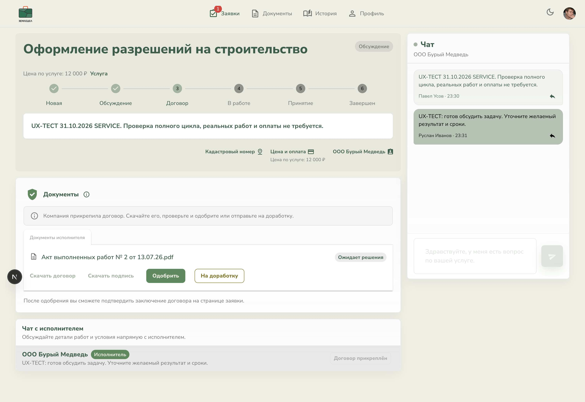

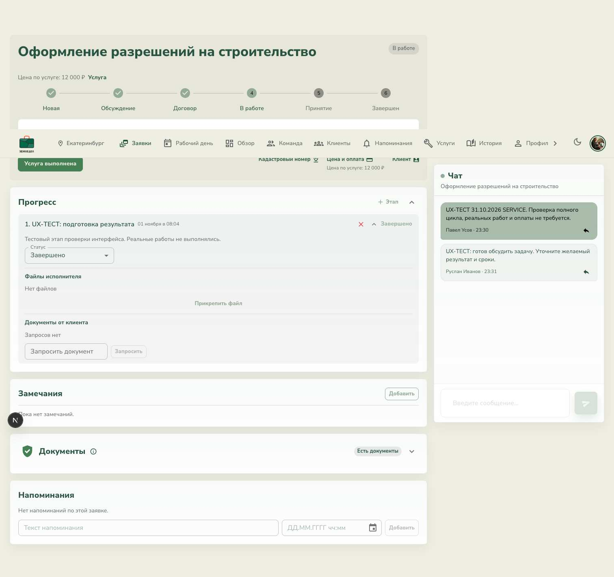

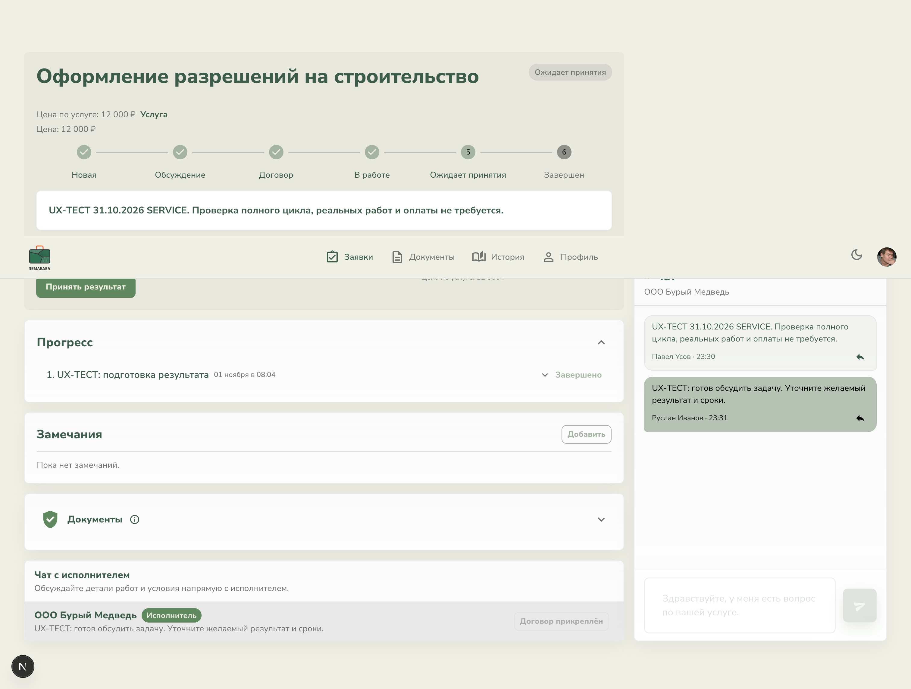

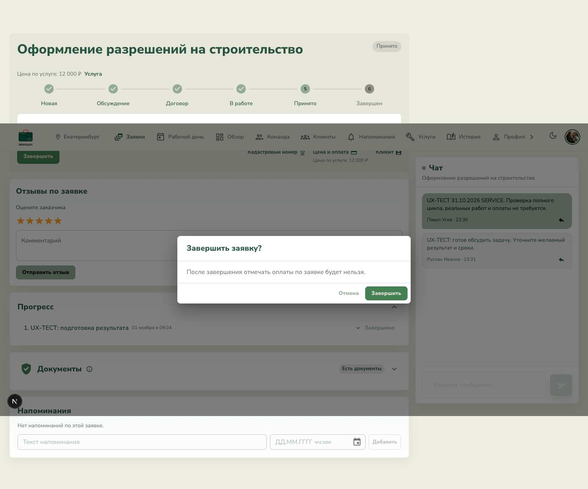

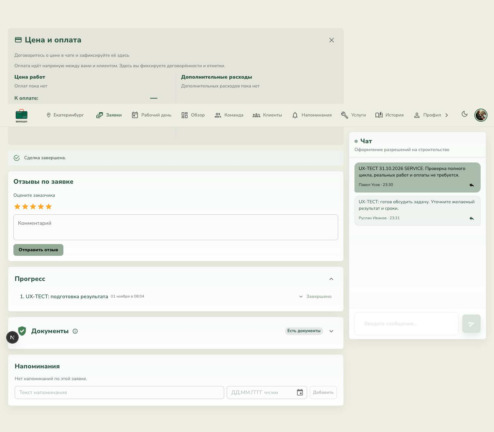

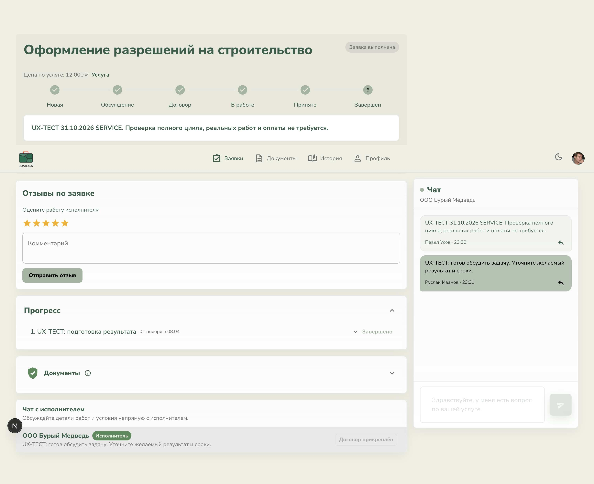
