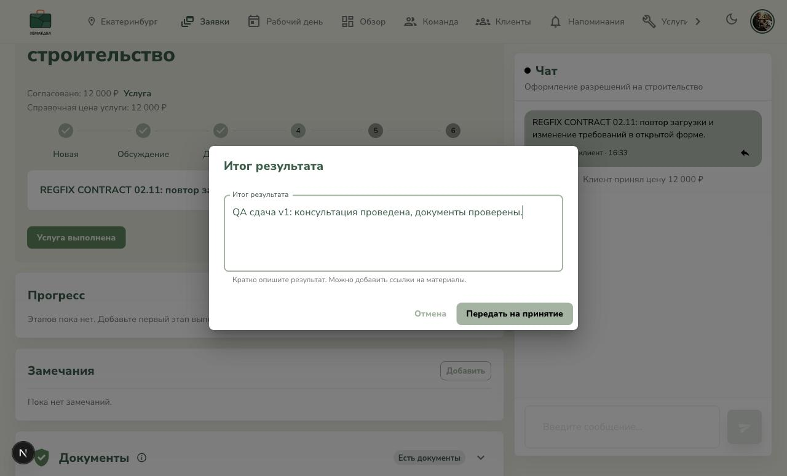
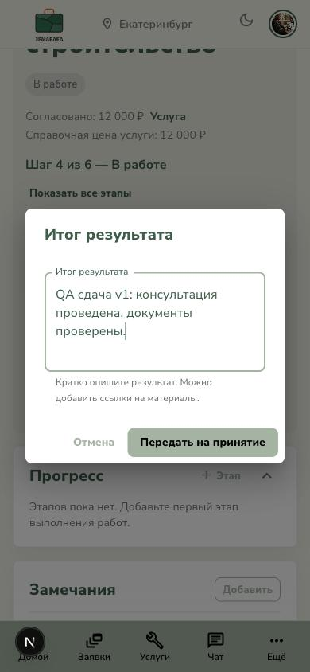

# Видимость label в формах

Дата: 02.11.2026. Проверка на локальном приложении, Chrome DevTools MCP.

## Причина и исправление

Окно на скриншоте — `RequestLifecycleActions`, модальное окно сдачи результата
исполнителем. MUI задавал `padding-top: 0` у DialogContent после DialogTitle.
Поднятый label начинался на 9 px выше области прокрутки и обрезался.

В `frontend/core/theme/createAppTheme.ts` добавлены общие правила:

- Контент диалога после заголовка, содержащий InputLabel, имеет верхний отступ
  16 px. Прокрутка сохранена; информационные диалоги без label не затронуты.
- Label в фокусе использует `text.primary` вместо слишком светлого primary.
  Error/disabled исключены, контекстные белые подписи RainGlassPaper сохранены.

Просмотрены все 13 мест использования DialogContent и общие стили InputLabel,
TextField, контейнеров с overflow. Проверен LocationDialog с собственным pt: 0:
у поиска нет плавающего label, а обёртка поля уже имеет padding 16 px.
Общий стиль охватывает сдачу/повторную сдачу, ответы обеих ролей, подтверждения
с причиной, запрос документов и редакторы админки. Остальные поля получают
контрастный цвет фокуса через MuiInputLabel.

## Проверка

| Состояние | Результат |
|---|---|
| До правки, заполненный итог | label top 300.79, DialogContent top 309.79: верх обрезан. [01](01-before-desktop.jpg) |
| После, desktop 1280 px | label top 308.79, DialogContent top 301.79: label внутри; padding 16 px, overflow auto; цвет rgb(50,94,73). [02](02-after-desktop.jpg) |
| Mobile 390 px | label виден целиком, горизонтального переполнения нет. [03](03-after-mobile.jpg) |
| Mobile, тёмная тема | label виден целиком. [04](04-after-mobile-dark.jpg) |
| Запрос документа, однострочный TextField | label виден, rgb(50,94,73), контент с dividers сохраняет отступ. Форма закрыта без отправки. [05](05-document-name.jpg) |
| Пустой итог и ошибка валидации | label не обрезан, error остаётся красным rgb(229,57,53). Запрос сдачи не отправлялся. [06](06-validation-label.jpg) |
| Вход на стеклянном фоне | label Email в фокусе сохранил rgba(255,255,255,0.9). [07](07-glass-form-labels.jpg) |
| Создание услуги | Фокус последовательно проверен на категории, названии, описании, цене, локации, метке: подписи не обрезаются контейнерами. Ничего не опубликовано. |

- Тесты темы, сдачи результата и документов: **11/11**, 3 файла.
- Frontend lint: 0 ошибок, прежние 4 предупреждения.
- Frontend production build: успешно.
- `git diff --check`: успешно.

Не заявляется ручной обход каждой страницы: все формы рассмотрены по исходникам,
представительные состояния проверены в браузере. Админские редакторы покрыты
общим правилом, но UI под текущим исполнителем недоступен. Временных QA-страниц
не добавлялось, бизнес-данные не менялись. На тестовый стенд правка не развёрнута.

