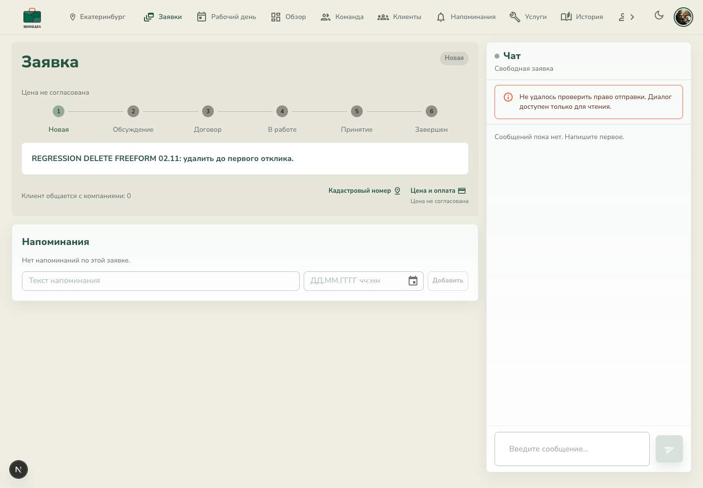
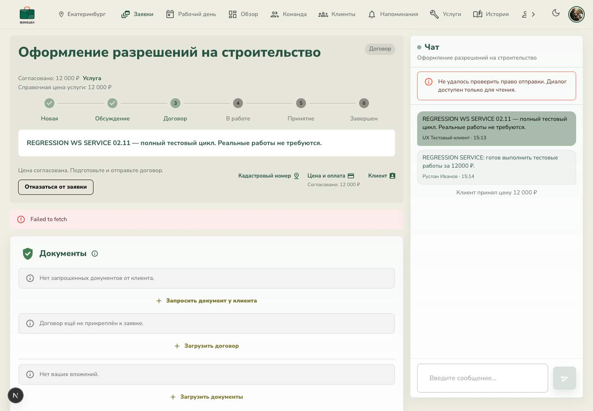
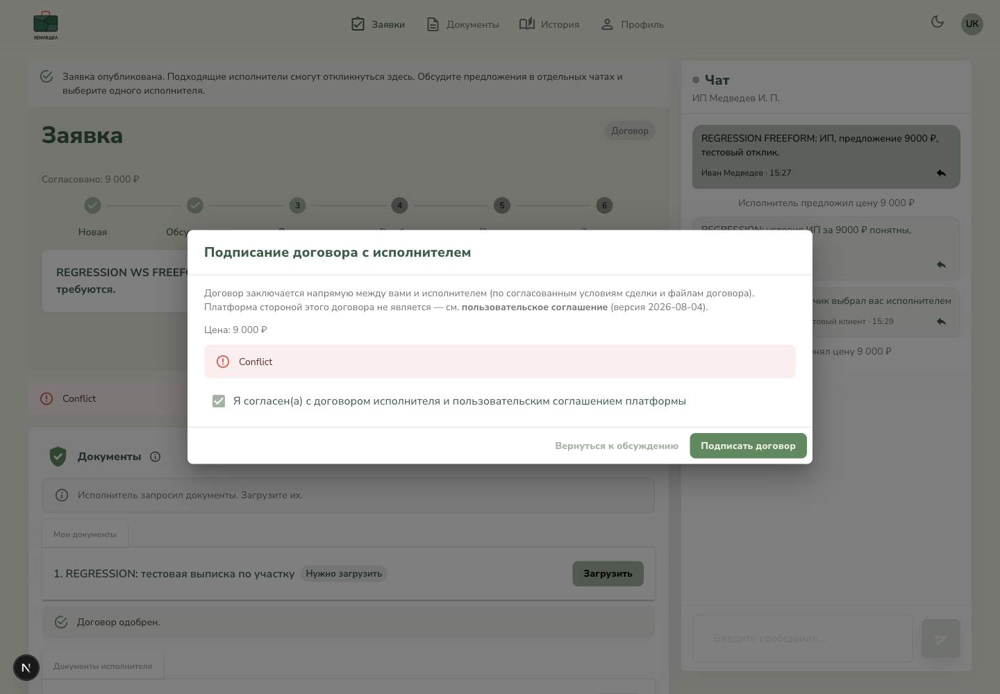

# SERVICE / FREEFORM после перехода на WebSocket

Дата: 02.11.2026. Проверена локальная сборка ветки `dev`, HEAD `4ed829c`.
Адрес: `http://localhost:4000`, backend `:4003`, Chrome DevTools MCP.

**Обновление после правок:** найденные ниже P1/P2 исправлены и повторно проверены;
P3 исправлен и покрыт автоматической проверкой. Результат и ограничения повтора —
в [отчёте исправлений](../regression-fixes/report.md). Ниже сохранён исходный
результат регрессии до этих изменений.

**Итог: оба основных пути доведены до COMPLETED, но регрессия целиком не закрыта.**
Подтверждён один P1 по удалению открытой заявки, два P2 по обработке ошибок
и небольшая неточность P3 в подсказке после выбора исполнителя.
Код приложения в этой проверке не менялся. Коммит и push не выполнялись.

## Сессии и записи

Использованы три прежние изолированные вкладки, новых вкладок не создавалось:
клиент `photoburg@yandex.ru`, ООО «Бурый Медведь», ИП Медведев.
Все создаваемые задачи, сообщения, файлы и отзывы помечены как тестовые.
Реальные работы, оплаты и отправка внешних уведомлений не выполнялись.

| Запись | ID | Итог |
|---|---|---|
| SERVICE, ООО | `dd9958dd-f38c-40cb-b970-9ead8906a3d9` | COMPLETED; 12 000 ₽; оплачено 12 000 ₽; остаток 0 ₽; две сдачи; оценки 4 и 3 |
| FREEFORM, выбран ИП | `425bd5b5-0000-420b-be4e-071d0df40f19` | COMPLETED; 9 000 ₽; оплачено 9 000 ₽; остаток 0 ₽; одна сдача; оценки 5 и 4 |
| FREEFORM для удаления до отклика | `c3ccaddd-0fa8-477b-89dc-03a4fd7cbac1` | Удалена клиентом; API 404; открытая карточка исполнителя остаётся устаревшей |

## Шаги и результаты

| Шаг | Проверка | Результат / доказательство |
|---|---|---|
| 1 | SERVICE с карточки услуги | Создана UI, ровно одна запись, вопрос и участок `66:41:0000000:701` сохранены. [Форма](01-service-form.jpg), [карточка](02-service-created.jpg). Исполнитель известен; выбора компаний нет. |
| 2 | Ответ исполнителя и согласование цены | Сообщение получено клиентом; клиент принял 12 000 ₽ через панель цены. У исполнителя обновился шаг договора. |
| 3 | Ошибка формата / сети при договоре | FAIL UX: неподдерживаемый файл — HTTP 500; сеть — `Failed to fetch`; диалог закрывается, выбранные файлы теряются. [Формат](03-invalid-contract-error.jpg), [сеть](04-upload-offline-error.jpg). |
| 4 | Повторная загрузка корректного договора | PASS: тот же тестовый PDF загрузился без подписи, появился у клиента по событию. Скачивание — HTTP 200, 32 584 байта, SHA-256 совпал с исходником. [Договор у клиента](05-service-contract-arrived.jpg). |
| 5 | Одобрение и заключение SERVICE-договора | PASS: явный чекбокс и подтверждение перевели заявку в ACTIVE без обязательного `.sig`. [Исполнитель в работе](06-service-active.jpg). |
| 6 | Публикация этапа | PASS: новый этап сразу появился у клиента, хотя статус остался ACTIVE. [Этап у клиента](07-service-stage-live.jpg). |
| 7 | Первая сдача → замечание → повторная сдача | PASS: клиент отправил замечание с подтверждением возврата в работу; исполнитель увидел его, повторная сдача блокировалась до выполнения замечания. После отметки и подтверждения создана версия 2. Версия 1 и выполненное замечание сохранились. [Замечание](08-service-remark-live.jpg), [две версии](09-service-second-submission.jpg). |
| 8 | SERVICE: принятие, завершение, поздняя оплата, отзывы | PASS: клиент принял результат; исполнитель завершил с долгом; ранее созданные 12 000 ₽ отмечены оплаченными после COMPLETED. Два явных рейтинга, оба отзыва видны. [Оплата и отзывы](10-service-completed.jpg). |
| 9 | Новая FREEFORM и два предложения | PASS: задача, Екатеринбург и участок `66:41:0000000:702` сохранены; providerId изначально null. Оба исполнителя ответили UI; клиент написал каждому в отдельном чате. Предложения ООО 11 000 ₽ и ИП 9 000 ₽ разделены. [Форма](11-freeform-form.jpg), [созданная заявка](12-freeform-created.jpg), [два отклика](13-freeform-two-offers.jpg). |
| 10 | Выбор ИП и потеря доступа ООО | PASS: у ООО была открыта панель цены; событие закрыло её и перевело карточку в архив без reload. Ввод чата отключён. Кадастр/финансы/документы/workflow скрыты. Финансы, договоры, замечания, этапы, документы и отзывы API — 403; изменение цены — 403. Чтение самого архивного DTO — 200 с `cadastralNumbers: []`, пустыми финансами и без деталей сдачи. [Архив](14-freeform-access-revoked.jpg). |
| 11 | FREEFORM: договор и документ клиента | Клиент принял 9 000 ₽, одобрил PDF без подписи. Исполнитель запросил выписку. FAIL UX: преждевременное заключение договора даёт `Conflict`. После загрузки выписки исполнителю по событию показан файл, заключение договора успешно. [Conflict](15-freeform-contract-conflict.jpg), [документ у исполнителя](16-freeform-customer-document-live.jpg). |
| 12 | Архивный чат клиента во время работы | PASS: клиент вручную открыл архив ООО; публикация этапа ИП обновила прогресс и сохранила именно архивный чат. Кнопка перехода к выбранному исполнителю вернула диалог ИП. [Сохранённый архив](17-freeform-archive-stays-open.jpg). |
| 13 | FREEFORM: сдача → принятие → завершение → новый поздний платёж | PASS: итог версии 1 виден клиенту; принятие и завершение подтверждены. Уже после COMPLETED исполнитель создал новый платёж 9 000 ₽, клиент увидел и отметил его оплаченным; остаток 0 ₽. Оба отзыва опубликованы. [Итог](18-freeform-completed-late-payment.jpg). |
| 14 | Удаление до первого отклика | У клиента PASS: есть предупреждение и подтверждение, затем переход в список, запись исчезает. У открывшего карточку исполнителя FAIL: API 404, события нет, экран остаётся «Новая», даже после focus-refresh. [Устаревшая карточка](19-deleted-request-stale-provider.jpg). Навигация на тот же URL показывает стандартную англоязычную 404. [404 после перехода](20-deleted-request-after-navigation.jpg). |
| 15 | Запреты удаления и чужого доступа | PASS: DELETE обеих завершённых заявок — 409, данные не изменены. ИП не может прочитать SERVICE другого исполнителя — 403. ООО не может скачать договор выбранного ИП — 404, файл не выдан. |
| 16 | Мобильные финалы и простой | PASS: SERVICE 360 px и FREEFORM 390 px без горизонтального overflow; архив ООО 360 px без кадастра и финансов, ввод отключён. За 38 секунд простоя у клиента и исполнителя — 0 API-запросов данных (auth исключён). [SERVICE](21-service-final-mobile.jpg), [FREEFORM](22-freeform-final-mobile.jpg), [архив](23-freeform-archived-final-mobile.jpg). |

Клиентские документы SERVICE и FREEFORM в положительных циклах обновлялись без
ручной перезагрузки: `performance.timeOrigin` от момента создания карточки до
COMPLETED совпал. События `request:changed` зарегистрированы в браузере:
17 в SERVICE до финального контрольного чтения, 28 в FREEFORM. Смена viewport
и отдельные проверки навигации выполнялись уже после завершения основных циклов.

## P1-01 — удалённая заявка остаётся открытой как действующая

**Воспроизведение:** создать FREEFORM, открыть её под исполнителем, не отвечать,
удалить под клиентом. Клиент попадает в список, GET исполнителя возвращает 404,
но его вкладка сохраняет заголовок «Новая», задачу, кнопку финансов и напоминания.
`request:changed` при удалении не пришёл. Focus-refresh делает GET 404 и также
не убирает старую карточку. После обновления доступа чат закрывается общим
сообщением о невозможности проверить право, а не объясняет удаление.

Это дефект жизненного цикла экрана, а не доказательство возможности записи после
удаления: API уже не выдаёт заявку; несанкционированную запись не наблюдали.

**Причина, подтверждённая чтением кода:**

- `backend/src/requests/request-realtime.interceptor.ts`: после DELETE заново
  ищет Request; `if (!request) return` прекращает уведомление, поскольку строка
  уже удалена. Получателей нужно сохранить до успешного удаления.
- `frontend/widgets/pro-requests/ui/ProRequestDetails.tsx` и
  `frontend/widgets/customer-requests/ui/CustomerRequestConversationWorkspace.tsx`:
  `!response.ok` просто прекращает чтение и оставляет старый snapshot.

**Критерий исправления:** событие удаления после commit получает прежний набор
участников; открытые экраны переходят в явное русское terminal-состояние,
закрывают панели и запрещают все действия. Пропущенное событие восстанавливается
через HTTP 404/403 на reconnect/focus. Отличать отсутствие/утрату доступа от
временного 5xx; не затирать пригодный экран при сетевом сбое. Нужны тесты успешного
удаления, отказа DELETE без события, пропущенного события и удаления при открытой
панели. Английскую малоконтрастную 404 заменить понятным состоянием с возвратом
к заявкам.

## P2-01 — ошибка загрузки закрывает диалог и теряет выбранные файлы

**Воспроизведение:** в SERVICE загрузить `invalid.exe` через поле документа;
получить HTTP 500 и «Не удалось загрузить договор». С корректным PDF повторить
отправку при эмуляции Offline; получить `Failed to fetch`. Диалог закрывается
в обоих случаях, для повторения требуется заново выбрать файл. После
восстановления сети и нового выбора корректный PDF успешно загружен, частичного
пакета от неуспешных попыток у клиента не появилось.

**Причины:** `fileFilter` в `backend/src/contract-files/contract-files.controller.ts`
вызывает обычный Error для неподдерживаемого типа. `uploadContractBundle` в
`ProRequestDetails.tsx` перехватывает ошибку без сигнала неуспеха вызывающему
компоненту. `ProRequestDocumentsSection.tsx` после fulfilled callback безусловно
закрывает диалог и очищает File-состояние.

**Критерий исправления:** ожидаемая ошибка типа/размера — 4xx с понятным текстом;
сетевой сбой — русское объяснение и повтор; диалог и выбранные файлы сохраняются
до подтверждённого успеха; повтор не создаёт дубликат пакета. Не показывать
ложный успех. При фактической утрате доступа закрывать форму и объяснять причину.

## P2-02 — попытка заключить договор до загрузки документа даёт Conflict

**Воспроизведение:** в выбранной FREEFORM согласовать цену и одобрить договор,
исполнителем запросить документ клиента, клиентом не загружать его и нажать
«Заключить договор» → чекбокс → «Подписать договор». UI показывает `Conflict`
без следующего действия. Сам запрет корректен: backend требует загрузить
запрошенные документы. После их загрузки тот же сценарий проходит.

**Критерий исправления:** до выполнения требований показать конкретную причину
блокировки и действие «Загрузить документы»; при изменении условий между открытием
формы и отправкой обработать серверный код конфликта понятным русским сообщением.
Не обходить серверное требование. Проверить stale-форму и повтор после загрузки.

## P3-01 — подсказка публикации не соответствует текущему шагу

В новой FREEFORM на этапе договора, уже после выбора ИП и согласования цены,
сверху остаётся сообщение «Обсудите предложения в отдельных чатах и выберите
одного исполнителя» ([состояние договора](15-freeform-contract-conflict.jpg)).
`createdNotice` зависит от начального `justCreated`, а не от текущего шага заявки.
Скрывать или менять эту подсказку после первого ответа/выбора исполнителя.

## Метод и ограничения проверки

- Все положительные изменения выполнялись штатными UI-формами: создание,
  сообщения, цены, выбор исполнителя, документы, статусы, замечание, отзывы,
  платёж и его отметка. API применялось для контрольных чтений и намеренно
  запрещённых операций (цена архивного исполнителя, удаление завершённых заявок).
- Нативный Chrome MCP upload запрещает файловые пути из-за своих workspace roots.
  Файлы переданы в наблюдаемые `<input type=file>` через браузерные File и
  DataTransfer; отправку выполнял интерфейс. Взяты точные байты ранее
  предоставленного тестового PDF, без изменения документа. `.sig` не прикладывали:
  подпись опциональна. Проверка не охватывает системный диалог выбора файла.
- SHA-256 PDF до загрузки и после скачивания:
  `ca50439cced82b73cc83c4905206db3865a32a4f9ef8c88b8a231d41b660062f`.
- Некорректные попадания автоматизации в скрытый rating-input или старый UID не
  считались дефектами продукта; действие повторялось по свежему DOM/видимому label.
- В Offline проверяли сбой отправки и восстановление возможностью повторной
  загрузки. Первичная ошибка доступа чата исчезла после следующего успешного
  события заявки; мгновенное восстановление только по OS-событию online не доказано.
- Ожидание реальных семи дней автоприёмки, multi-instance backend, production/CDN,
  физические мобильные устройства и полная accessibility-проверка не проводились.
  У 404 визуально виден низкий контраст белого текста на светлом фоне.
- Общие automated suites не перезапускались: это UI-регрессия без изменений кода.
  Ранее пройденные тесты не подменяют текущие браузерные результаты.

**Следующее действие:** исправить P1-01 и оба P2, затем повторить три негативных
сценария и их восстановление. До этого не считать полную регрессию закрытой.

## Скриншоты основных дефектов

### P1-01: удалённая заявка всё ещё выглядит действующей

### P2-01: ошибка отправки файла с потерей формы

### P2-02: непонятный Conflict при заключении договора

