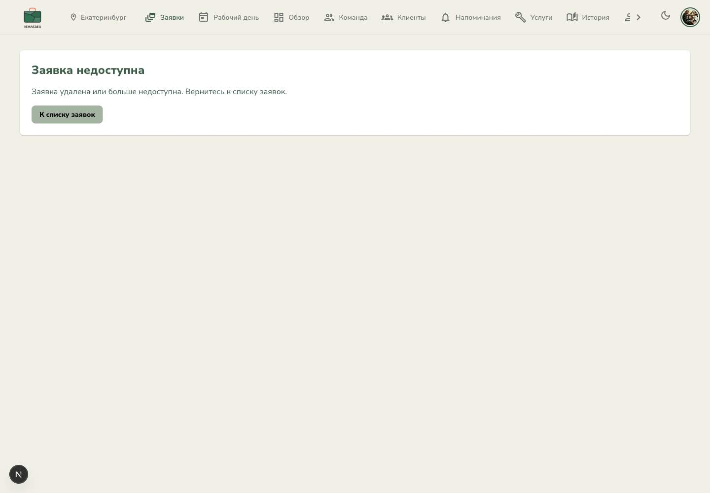
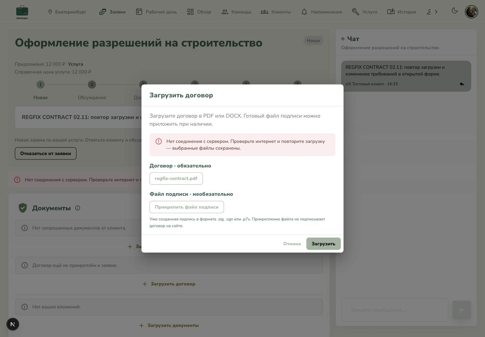
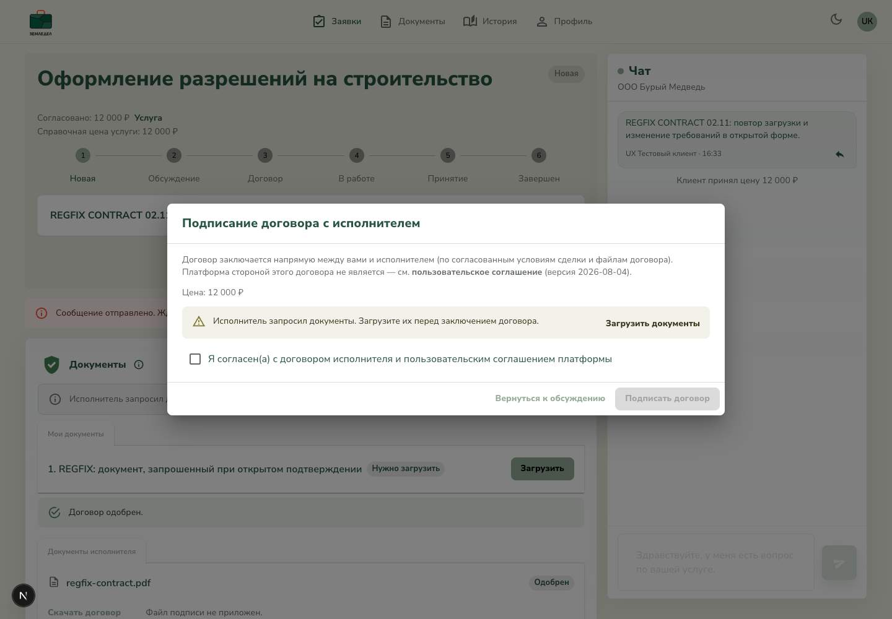

# Исправления после SERVICE / FREEFORM регрессии

Дата: 02.11.2026. Ветка `dev`, правки поверх `4ed829c`.
Исходный прогон: [post-websocket-regression/report.md](../post-websocket-regression/report.md).

## Изменения

1. **P1-01, удаление открытой заявки.** Получатели уведомления сохраняются до
   удаления строки Request. Событие посылается после успешного завершения
   контроллера; отклонённый DELETE его не посылает. Открытые клиентский и
   исполнительский экраны обрабатывают 401/403/404, заменяют весь workspace
   понятным состоянием недоступности и убирают чат, панели и рабочие действия.
   Временный 5xx не стирает пригодный экран. У обеих detail-страниц есть русская
   not-found с возвратом к списку и обычным контрастом текста.
2. **P2-01, загрузка договора.** Неподдерживаемый формат на сервере возвращает
   422 вместо 500; клиент проверяет формат и лимит 20 МБ. Ошибка загрузки
   больше не превращается в fulfilled callback: диалог и выбранные File
   сохраняются, ошибка объясняется по-русски. Очистка формы происходит после
   успешной загрузки. Сбой обновления списка после уже успешной записи не
   предлагает загрузить тот же договор ещё раз.
3. **P2-02, открытое подтверждение договора.** Новый запрос документа по
   WebSocket меняет условия уже открытой формы, сбрасывает согласие и блокирует
   подтверждение. Есть объяснение и действие «Загрузить документы». При
   серверном конфликте парсер берёт содержательный `message`, а не HTTP-label
   `error: Conflict`; подпись больше не называется обязательной в ошибке.
4. **P3-01, подсказка создания.** Приветственное сообщение ограничено начальным
   NEW-состоянием; у свободной заявки оно скрывается после выбора исполнителя.

## Автоматические проверки

- Backend: **375/375**, 73 файла.
- Frontend: **585/585**, 129 файлов в финальном полном последовательном прогоне
  после исправления client-boundary.
- Backend build и lint: успешно, 0 ошибок, прежние 311 предупреждений.
- Frontend build и lint: финальный повтор после исправления client-boundary
  прошёл успешно, 0 ошибок, прежние 4 предупреждения.
- `git diff --check`: успешно.

Добавлены проверки удаления после фактического исчезновения строки, отсутствия
события при отказе DELETE, 401/403/404 и снятия целого workspace, восстановления
пропущенного события через focus, сохранения экрана при 503, сохранения обоих
файлов после ошибки и явного повтора, реального multipart 422 в Nest до вызова
хранилища, загрузки без `.sig`, локализации сетевого сбоя, формата/размера,
специфического серверного конфликта и изменения открытой формы договора.

Сначала Mac был сильно перегружен (load average около 261, swap около 34 ГБ).
Полученные тогда таймауты не считались пройденными проверками. По просьбе
пользователя дальнейшие проверки выполнялись последовательно, с одним worker.
`--testTimeout=60000` использован только в командах этого локального прогона;
таймауты проекта не изменены.

## Повтор в Chrome DevTools

Использованы прежние три тестовые сессии: клиент, ООО «Бурый Медведь», ИП Медведев.
Chrome восстановил вкладки в процессе проверки; после этого использованы новые
ID тех же сессий. Доказательства до и после восстановления разделены по шагам.

| Шаг | Что проверено | Итог |
|---|---|---|
| 1 | Удаление новой FREEFORM `cb56f4a6-ad26-4889-bd57-8f99af5b3951`, открытой у ООО | PASS: событие пришло; без reload старые данные, финансы и чат исчезли, показан terminal-экран. [01](01-deleted-request-realtime.jpg) |
| 2 | Прямой URL удалённой заявки под исполнителем | PASS: русская not-found и ссылка на список. В проверке исправлена обнаруженная ошибка передачи Next Link из server в client; компонент помечен `use client`, результат повторно проверен после hard reload. [02](02-deleted-request-direct-url.jpg) |
| 3 | Намеренное подавление события на новой FREEFORM `ef459c8f-4fd7-415d-b428-1df4b8f5d2cf` | Подавлено 1 событие, клиент подтвердил удаление и вернулся к списку, API исполнителя — 404. После восстановления слушателей и focus terminal виден без смены документа. [03](03-missed-delete-focus-recovery.jpg). Исключительность именно focus как первого триггера в браузере не заявляется; точный порядок «503 сохраняет экран → 404 при focus закрывает» отдельно проверен детерминированным unit-тестом. |
| 4 | Неподдерживаемый файл в SERVICE `420c5ad9-a17c-4c77-b060-5b61a3e1d9fa` | PASS: UI сохраняет окно и `invalid.exe`, показывает «Выберите договор в формате PDF или DOCX». Отдельная multipart-отправка в реальный API вернула 422 с русским сообщением. [04](04-invalid-file-kept-with-message.jpg) |
| 5 | Корректный PDF, отправка при Offline | PASS: сообщение о соединении, тот же `regfix-contract.pdf` остаётся выбранным, кнопка повтора доступна. После возврата сети — повтор без нового выбора, ровно 1 пакет в API, форма закрылась после успеха. [05](05-network-error-file-kept.jpg) |
| 6 | Клиент согласовал 12 000 ₽, одобрил договор, открыл подтверждение и поставил чекбокс; исполнитель в этот момент запросил документ | PASS: в том же документе чекбокс сброшен, подтверждение отключено, есть понятная причина и переход к загрузке вместо Conflict. [06](06-open-contract-updated-requirements.jpg) |
| 7 | Восстановление после выполнения требований | PASS: «Загрузить документы» закрыла окно, PDF клиента загружен; новое явное подтверждение заключило договор. API — ACTIVE, contractAcceptedAt заполнен, документ браузера тот же. [07](07-contract-recovery-active.jpg) |
| 8 | Удалённая заявка под клиентом на 390 px | PASS: русский terminal, ссылка `/profile?section=requests`, горизонтального переполнения нет. [08](08-customer-unavailable-mobile.jpg) |

Промежуточная попытка подавления события на записи
`9e52c32f-d5f9-4eff-ab05-789f92991072` не изолировала момент commit: контрольное
чтение выполнилось до завершения DELETE. Она исключена из доказательства этого
порядка; запись также удалена. Это не новое падение продукта.

В ходе повторного запуска dev backend потребовался перезапуск после сборки.
Watcher перезапущен с временным переводом строки в main.ts; исходные байты
полностью восстановлены и отсутствие diff проверено. Временные maintenance/
error-экраны от остановленного backend и устаревших browser chunks не приняты
как успешные скриншоты; финальные файлы пересняты в правильном состоянии.

## Доказательства

## Границы

- Это повтор конкретных отрицательных сценариев и их восстановления. Положительные
  полные SERVICE/FREEFORM до COMPLETED находятся в исходном отчёте; в этом повторе
  новая SERVICE доведена до ACTIVE после восстановления загрузки и требований.
- File передавался в штатные input через File/DataTransfer из-за ограничения
  workspace-roots у нативного Chrome MCP upload. Отправку выполнял UI. Использован
  ранее предоставленный тестовый PDF; подпись не обязательна и не прикладывалась.
- Повтор сети проверен при Offline до записи на сервер. Потеря ответа после
  уже committed upload отдельно не эмулировалась; общей гарантии idempotency
  для неопределённого исхода загрузки здесь не заявляется.
- Подавление события выполнялось временными capture-слушателями только в тестовой
  вкладке; после проверки они сняты. Backend и ответы API не подменялись.
- P3 проверен автоматически; новый отдельный визуальный прогон hero не выполнялся.
- Реальные работы, платежи, production, push и коммит не выполнялись.
