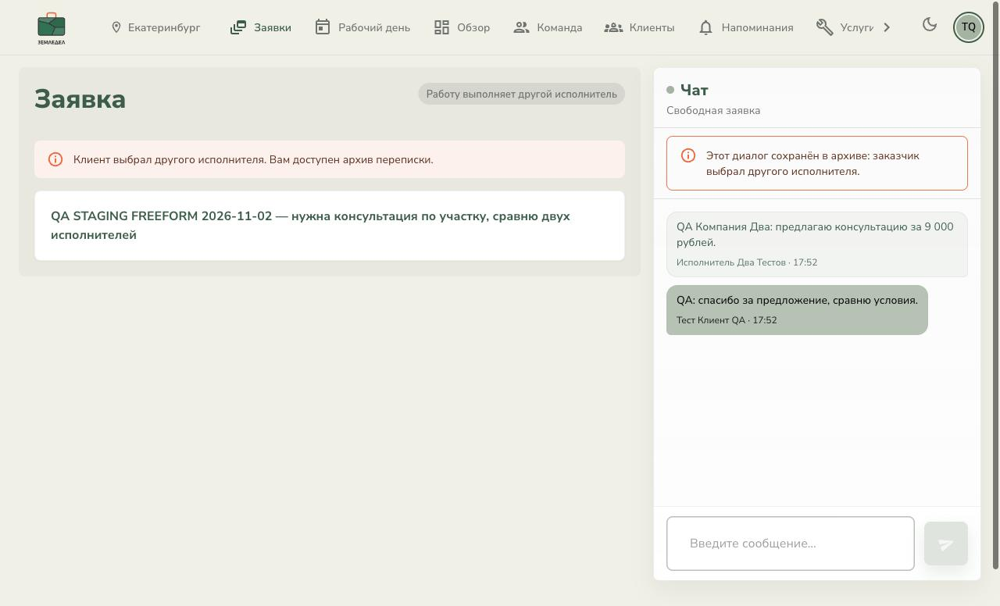
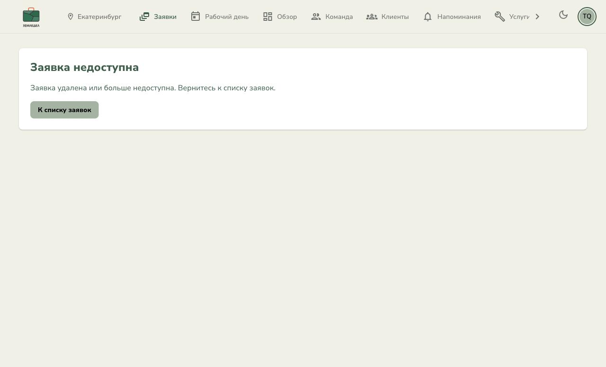
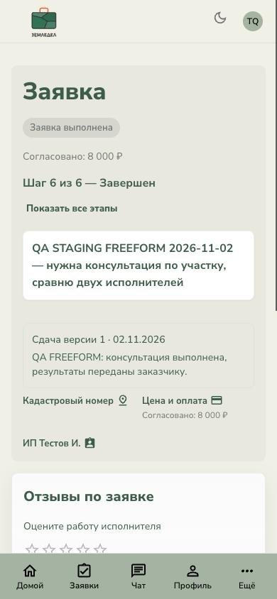

# Регрессия SERVICE / FREEFORM на ONREZA

Дата: 02.11.2026, Asia/Yekaterinburg.
Стенд: https://zemldel-frontend-brobear.onreza.app/.
Frontend deployment в панели ONREZA: `main`, `16aec6c`, статус «Готов».
Это merge PR [#16](https://github.com/brobearhub/zemldel/pull/16), содержащего `9ff1a68`.

## Итог

Оба новых пути пройдены через интерфейс до `COMPLETED`. Подтверждённых новых
блокирующих P1/P2 в проверенных сценариях не обнаружено. WebSocket работает
через внешний HTTPS/WSS-прокси. Ошибки загрузки, изменение условий открытого
договора, потеря доступа, восстановление после Offline и удаление проверены.
Пользователь сообщил, что письмо не пришло. Причина подтверждена в логах
ONREZA backend: SMTP не настроен, используется LogMailSender. Полный сброс
пароля через реальную почту заблокирован конфигурацией стенда.

## Данные и метод

Использован Chrome DevTools MCP, три изолированные сессии, по одной вкладке на
клиента и двух исполнителей. Чужие вкладки и пользовательский аккаунт на стенде
не изменялись. Созданы отдельные аккаунты:

- `qa.customer.20261102@example.com` — Тест Клиент QA.
- `qa.provider.20261102@example.com` — ИП Тестов И.
- `qa.provider2.20261102@example.com` — ООО «Тест QA Два».
- `photoburg@yandex.ru` — дополнительный клиент для согласованной проверки почты.

Пароли и reset-токены в репозиторий не сохраняются. Услуга помечена QA TEST.
Регистрация, создание профилей, публикация услуги, заявки и переходы состояний
выполнялись UI. Дополнительные API-запросы использованы для чтения результата,
проверки 403 и намеренно неверного multipart 422. Успешные переходы workflow
через API не подменялись.

Из-за ограничения workspace roots у Chrome MCP файлы передавались в штатные
input через File/DataTransfer. Отправлял файлы интерфейс. Использован ранее
предоставленный тестовый PDF 32584 байта; договоры загружены без подписи.
Фото услуги взято из уже существующего статического файла приложения.

## Сценарии и визуальные доказательства

| № | Шаг | Результат и доказательство |
|---|---|---|
| 1 | Гость, главная, различие двух способов обращения | PASS: оба объяснения видны; каталог первоначально пуст. [01](01-guest-home.jpg) |
| 2 | Регистрация клиента, ИП и организации; публикация QA-услуги | PASS: штатные формы; услуга появилась в каталоге, реквизиты не блокируют начало работы. |
| 3 | SERVICE с карточки услуги | PASS: известный исполнитель, отдельного выбора исполнителей нет. [02](02-service-created.jpg) |
| 4 | Ответ исполнителя и согласование 12000 ₽ | PASS: клиент увидел ответ и DISCUSSION без reload, явно принял цену. Начальная подсказка исчезла. |
| 5 | Неподдерживаемый договор | PASS: русская ошибка, диалог и invalid.exe сохранены. Реальный multipart API дополнительно вернул 422. [03](03-invalid-upload.jpg) |
| 6 | Ошибка сети при загрузке и повтор | PASS: Offline до отправки, PDF сохранён; после возврата сети повтор без перевыбора, один пакет в API. [04](04-offline-file-kept.jpg) |
| 7 | Новое требование при открытом подтверждении | PASS: после запроса документа чекбокс сброшен, кнопка отключена, есть действие загрузки. [05](05-contract-requirements-live.jpg) |
| 8 | Выполнение требований и заключение договора | PASS: PDF клиента загружен, договор скачивается 200 application/pdf, повторное явное согласие перевело в ACTIVE без reload второй роли. [06](06-service-active.jpg) |
| 9 | Этап, сдача v1, замечание, исправление, сдача v2 | PASS: этап и замечание обновились между ролями; открытое замечание блокировало сдачу, после DONE появилась v2; история v1 и замечания сохранена. [07](07-service-second-delivery.jpg) |
| 10 | Приёмка, COMPLETED и поздняя оплата SERVICE | PASS: завершение с долгом допустимо; ранее созданная оплата отмечена после COMPLETED, остаток 0 ₽. Реального денежного перевода нет. [08](08-service-completed-late-payment.jpg) |
| 11 | FREEFORM, два отклика и отдельные чаты | PASS: клиент переключился между диалогами и ответил обоим до выбора ИП. [09](09-freeform-two-conversations.jpg) |
| 12 | Потеря доступа невыбранным исполнителем | PASS: без reload остались базовый контекст и собственный read-only чат. Нет кадастра/финансов/этапов/документов/напоминаний. [10](10-archived-provider-live.jpg) |
| 13 | Проверка серверных границ архива | PASS: GET payments, contract-bundles, document-requests, work-stages, remarks — 403; cadastralNumbers — []; попытка POST кадастра — 403. Поздний кадастр/договор/этап не появился в архиве. |
| 14 | FREEFORM: 8000 ₽, договор и восстановление связи | PASS: цена явно принята клиентом, договор одобрен и заключён. Во время Offline клиента исполнитель опубликовал этап; до возврата этапа нет, после возврата он появился при том же performance.timeOrigin. WSS затем снова открылся. [11](11-offline-recovery-stage.jpg) |
| 15 | FREEFORM: сдача, приёмка, завершение | PASS: новый результат принят, API COMPLETED; архив другого исполнителя сохранился. [12](12-freeform-completed.jpg) |
| 16 | Мобильные финальные состояния 390 px | PASS: SERVICE и FREEFORM без горизонтального переполнения. Это проверка финальных экранов, полный путь не повторялся с мобильной клавиатурой. [13](13-freeform-completed-mobile.jpg), [17](17-service-completed-mobile.jpg) |
| 17 | Удаление открытой новой FREEFORM | PASS: 1 request.changed, тот же timeOrigin у исполнителя, весь workspace и чат исчезли. [14](14-deleted-live-terminal.jpg) |
| 18 | Прямые URL после удаления | PASS: локализованные состояния обеих ролей, корректные ссылки на свои списки; клиент 390 px без overflow. [15](15-deleted-direct-provider.jpg), [16](16-deleted-direct-customer-mobile.jpg) |
| 19 | Отзыв SERVICE | PASS: 5 звёзд и явно тестовый комментарий сохранены, подтверждено повторным открытием; в каталоге появился рейтинг 5.0. [18](18-service-review.jpg) |
| 20 | Восстановление пароля по почте | BLOCKED: с разрешения пользователя зарегистрирован photoburg@yandex.ru, отправлен запрос восстановления. Пользователь не получил письмо. Логи backend подтверждают «SMTP не задан», используется LogMailSender. [19](19-password-reset-requested.jpg) |

## Технические подтверждения

- Первое WSS-соединение обеих SERVICE-ролей успешно открыто к
  `wss://zemldel-brobear.onreza.app`, ошибок до Offline не наблюдалось.
- SERVICE клиент: `performance.timeOrigin = 1793623216007.2` сохранялся от
  начала проверки live-обновлений до COMPLETED и поздней оплаты.
- FREEFORM при Offline: `performance.timeOrigin = 1793624117105.3` до и после
  восстановления; этап отсутствовал офлайн и появился после возврата сети.
- Удаление: `performance.timeOrigin = 1793624459503.6` до и после terminal,
  `request.changed = 1`; формы чата больше нет.
- В отдельном интервале 39.355 секунды покоя в завершённой FREEFORM исполнителя
  не добавилось ни одного ресурса `/api/pro/requests/` в Performance API.
  Это ограниченная проверка отсутствия регулярного polling на данном экране.
- CI для `9ff1a68` на dev и merge `16aec6c` на main прошёл:
  [dev](https://github.com/brobearhub/zemldel/actions/runs/41442880365),
  [main](https://github.com/brobearhub/zemldel/actions/runs/41443358389).
  Workflow покрывает PostgreSQL race/cancel-provider-selection/select-provider;
  он не является полным frontend/backend CI.

## Ограничения и оставшиеся шаги

- SMTP: настроить SMTP_HOST, SMTP_PORT, SMTP_USER, SMTP_PASSWORD, SMTP_FROM
  на backend и повторить reset, новый вход и одноразовость ссылки. Настройки
  отправителя не менялись. Домен reset-ссылки в логе правильный:
  https://zemldel-frontend-brobear.onreza.app/reset-password; токен не сохранён.
- Не проверялись длительная недоступность backend, истечение сессии по времени,
  автоматическая приёмка через 7 дней и доступность со скринридером.
- Offline проверен до отправки. Exactly-once при потере ответа после commit
  этим прогоном не доказан.
- При смене чатов наблюдались короткие промежуточные loading-состояния; они не
  принимались как итог. Screenshot со спиннером оплаты и промежуточным архивом
  заменён финальным устойчивым состоянием.
- У Chrome MCP были трудности с textarea, скрытым radio оценки и координатами
  элементов около sticky header. Для ввода использовался штатный DOM input
  event, для оценки — click штатного radio, кнопки прокручивались в центр.
  Одна ошибочная навигация клиента в документы исправлена возвращением к заявке;
  после неё измерения FREEFORM timeOrigin начаты заново.
- Исходники, настройки стенда, deployment и бизнес-логика в этом прогоне не
  менялись. В рабочую директорию добавлены только отчёт и скриншоты.

## Идентификаторы для повтора

- Услуга: `8085e552-282e-4396-9d96-fcd4ab9686f8`.
- SERVICE: `81bc5597-664f-452b-a3fc-593176698d75`, COMPLETED, остаток 0 ₽.
- FREEFORM: `2432f725-ebda-4ff3-866c-4c73636799b7`, COMPLETED.
- Удалённая: `878e233e-3391-4217-8849-1ed0d71446bd`.

