# Повторный UX-аудит «Земледел» — 03.11.2026

## Область и результат

Проверено текущее локальное приложение на `localhost:4000` через Chrome DevTools MCP: гость, клиент, выбранный и невыбранный исполнители. Использованы три существующие изолированные вкладки. Desktop: 1280×776 и 1440×900; mobile: 390×844, эмуляция touch. Приложение работает с предыдущими локальными незакоммиченными исправлениями.

Найдено **семь актуальных направлений улучшения уровня P2**: пользователь может продолжить работу, но интерфейс теряет ввод, скрывает важные данные или затрудняет выбор следующего действия. Первыми стоит исправить оплаты, черновик FREEFORM и контекст чатов. Это не семь гарантированно новых дефектов: например, устройство «Рабочего дня» уже обсуждалось и вновь подтверждено на текущем UI. Нового блокирующего P1 в просмотренных состояниях не подтверждено.

Код приложения не менялся. Новые заявки, оплаты, сообщения, договоры и отзывы не создавались. В гостевой форме вводился только тестовый черновик без публикации; после проверки гостя клиентская сессия восстановлена. Черновик чата второго исполнителя сохранён.

## Проверенные шаги

| Шаг | Поверхность и действие | Состояние | Доказательства |
| --- | --- | --- | --- |
| 1 | Главная гостя: выбор каталога или своей заявки | Два пути понятны; низкий контраст пояснений | 10, 17 |
| 2 | FREEFORM: открыть, заполнить описание, закрыть и открыть снова | Ввод потерян; причина недоступности «Продолжить» не объяснена | 11–13 |
| 3 | SERVICE: открыть карточку и перейти кнопкой к форме | Переход работает; есть мелкие недочёты мобильной компоновки | 14–15 |
| 4 | Клиент: найти и проверить полученный договор | Решение доступно; действие спрятано ниже общей информации и выполненных загрузок | 01–02, 04 |
| 5 | Клиент и исполнитель: открыть «Цена и оплата» на телефоне | Назначение платежа скрыто, неоплаченная запись выглядит оплаченной | 03, 16 |
| 6 | Клиент: перейти из списка чатов в FREEFORM-переписку | Переписка открывается, но не хватает идентификации заявки и собеседника | 05–06 |
| 7 | Исполнитель: полученный договор и «Рабочий день» | Подсказка договора отстаёт от состояния; пустые услуги вытесняют работу | 07–09 |
| 8 | FREEFORM после завершения: выбранный и невыбранный исполнители | Итог, версии сдачи и архивные ограничения понятны | 18–19 |

## UX-01 · P2 · Мобильные оплаты скрывают назначение и смешивают действие со статусом

**Шаг 5; снимки 03, 16.** На ширине 390 px у записи 1 000 ₽ видна галочка и слово «Оплачено». Это кнопка с доступным именем «Отметить как оплачено», а не статус: контрольное авторизованное чтение вернуло `paidAt: null`, `paidAmountRubles: 0`. Общий остаток остаётся 12 000 ₽. Пользователь может решить, что тысяча уже учтена, и счесть остаток неправильным.

Одновременно назначение платежа исчезает: у элемента с `title="QA IDEMPOTENCY payment lost response"` фактическая ширина **0 px**, `scrollWidth=268`. Сетка отдаёт место сумме и действию, сжимая текст до нуля. Длинный текст тестовой записи не является достаточным объяснением: нулевая ширина не позволяет показать даже короткое назначение.

**Предложение:** на мобильном показывать платеж отдельной строкой/карточкой: назначение на всю ширину, ниже сумма, явный статус «Не оплачено» и отдельная кнопка «Отметить оплату». После подтверждения заменить действие статусом «Оплачено». Финансовую модель менять не требуется.

**Критерий:** на 320/360/390 px читаются назначение, сумма и статус каждого платежа; нет горизонтального переполнения; до подтверждения нет визуальной подписи, которую можно принять за состоявшуюся оплату. Проверить несколько платежей и длинные назначения.

Код: `frontend/widgets/request-payments/ui/RequestPayments.tsx`, `PaymentListRow`, сетка сумм и действий.

## UX-02 · P2 · Закрытие FREEFORM уничтожает незавершённый ввод

**Шаг 2; снимки 12–13.** В мобильной форме «Своя заявка» введено описание задачи. После крестика и повторного открытия textarea пуста. Подтверждение потери ввода не показывалось. Повторено дважды. До кнопки «Продолжить» пользователь ещё не дошёл, поэтому сохранение заявки для входа/регистрации этот случай не покрывает.

**Предложение:** сохранять черновик по мере ввода и восстанавливать при повторном открытии. Закрытие окна сохраняет работу; отдельное действие «Очистить» удаляет её. Разделять черновики по пользователю и типу заявки. Согласовать срок хранения, особенно для гостя.

**Критерий:** описание, выбранная локация и участки переживают закрытие окна; после отправки черновик очищается; данные другого пользователя не подставляются. Перезагрузка страницы и смена мобильного/desktop представления должны иметь явно согласованное поведение.

Код: `frontend/widgets/public-service/ui/PublicUnlinkedRequestForm.tsx`, `HomeMobileHelpButton.tsx` и родительские контейнеры формы.

## UX-03 · P2 · Список и отдельная страница чата теряют контекст заявки

**Шаг 6; снимки 05–06.** Несколько FREEFORM в списке названы просто «Заявка». Вторая строка часто содержит системное сообщение вроде «Заказчик выбрал вас исполнителем», которое не помогает различать задачи. У SERVICE повторяется название одной услуги; имена собеседников и статус работ в списке не показаны.

После открытия FREEFORM заголовок — только «Чат». Не видны название/описание задачи, выбранная организация, состояние заявки или ссылка обратно в её карточку. В основном содержимом этого экрана нет ссылок. Для обсуждения нескольких заявок пользователь должен запоминать контекст или искать заявку через общую навигацию.

**Предложение:** название/краткое описание задачи + организация/собеседник + статус + последнее сообщение. На странице переписки — компактная шапка с названием задачи, исполнителем, кнопками «К заявке» и «К чатам». Дату вынести из обрезаемого текста сообщения. Для FREEFORM с несколькими откликами сохранить явный выбор диалога.

**Критерий:** две свободные заявки и две заявки по одной услуге различимы без открытия; из любого чата можно одним действием попасть в нужную заявку; выбранная переписка однозначно обозначена.

Код: `frontend/widgets/chats/ui/ChatsInboxPage.tsx`, `ChatRequestPage.tsx`. Вторая сейчас передаёт панели только `title="Чат"` и ID заявки.

## UX-04 · P2 · Следующий шаг по договору не отражён в верхней части карточки

**Шаги 4 и 7; снимки 01–02, 04, 07.** У исполнителя договор уже загружен, блок документов показывает «Ожидает решения клиента», но верхняя подсказка говорит: «Цена согласована. Подготовьте и отправьте договор». Это воспроизводится на загруженном экране, не только в промежутке синхронизации.

У клиента первый мобильный экран занят названием, тремя упоминаниями цены, стадией, текстом заявки и служебными действиями. Кнопка «Одобрить» на проверенной записи находится примерно на **1477 px от начала документа**, после двух уже загруженных клиентских документов. Наверху нет явного перехода к ожидающему решения договору. Глубина зависит от числа документов; чем их больше, тем дальше действие.

**Предложение:** компактный блок «Сейчас нужно» под стадией. Клиенту — «Проверьте договор» с переходом к файлу и решению; исполнителю — «Договор отправлен, ждём решения клиента». Невыполненные действия ставить выше уже выполненных загрузок. Полную информацию и цену сохранить, сократив повторения в мобильной шапке.

**Критерий:** по первому экрану ясно, кто сейчас действует; после отправки договора подсказка загрузки исчезает; необходимый документ доступен одним переходом независимо от числа остальных файлов.

Код подсказки: `frontend/widgets/request-lifecycle-actions/model/request-lifecycle-model.ts`; дополнительно проверить клиентский/исполнительский контейнер карточки.

## UX-05 · P2 · «Рабочий день» начинается с услуг, по которым нет работы

**Шаг 7; снимки 08–09.** Первые две услуги имеют по нулю заявок и занимают крупные блоки с фотографиями. У третьей услуги есть 10 заявок, в том числе новые, но они находятся ниже. На desktop уже первая пустая область занимает сотни пикселей; на телефоне почти весь первый экран занимает одна услуга без заявок.

**Предложение:** первым показывать «Требует вашего действия» и актуальные заявки; услуги без заявок сворачивать или опускать ниже. Сохранить доступ к каталогу своих услуг отдельным разделом. В верхней части полезны счётчики ожидающих ответа, документов и замечаний.

**Критерий:** новая заявка или замечание попадает на первый экран при наличии любых пустых услуг; исполнитель видит, что сделать сегодня, без прокрутки рекламных карточек собственных услуг.

Это повторное подтверждение ранее обсуждавшегося направления, а не новый функциональный сбой.

## UX-06 · P2 · Белые пояснения в hero имеют низкий контраст

**Шаг 1; снимки 10, 17.** Из вычисленных стилей: фон `rgb(160,180,160)` (`#A0B4A0`), заголовок и пояснения белые. Контраст непрозрачного белого к этому фону — **около 2,20:1**, рассчитан по относительной яркости sRGB. У пояснений дополнительно используется opacity; нижняя строка ещё слабее. На телефоне ключевые различия двух способов обращения набраны размером 13 px.

**Предложение:** сохранить выбранную композицию и белый текст, но подобрать более тёмный зелёный фон именно для hero; убрать дополнительное ослабление ключевых пояснений. Изменение общего primary всей системы без отдельной проверки не предлагается. Если текущий светлый фон принципиален, потребуется обсудить цвет текста.

**Критерий:** оба пояснения читаются так же уверенно, как подписи кнопок; повторно измерить контраст финальных цветов и проверить desktop/mobile. Полное соответствие доступности по одному измерению не заявляется.

Код: `frontend/widgets/public-service/ui/HomeIntroBanner.tsx`.

## UX-07 · P2 · FREEFORM не объясняет обязательность локации

**Шаг 2; снимок 12.** Описание задачи заполнено, но «Продолжить» недоступна. Возле «Выбрать локацию» нет признака обязательности и объяснения, почему продолжение заблокировано. Код подтверждает: отсутствие города возвращает `isBlocked: true` с `validationError: null`.

**Предложение:** назвать поле «Где нужны работы? *» и при необходимости пояснить «Выберите населённый пункт». Давать видимую причину недоступности продолжения либо показывать ошибку у незаполненного поля после попытки отправки. Кадастровый номер оставить явно необязательным.

**Критерий:** гость без ранее выбранного города понимает, что заполнить после описания; ошибка связана с конкретным полем; выбор города убирает причину блокировки.

Дополнительно у открытого мобильного окна в accessibility snapshot отсутствует доступное имя: `dialog modal`, без «Нужна помощь?». Нужно связать диалог с видимым заголовком. Возврат фокуса после закрытия на «Своя заявка» работает — это сохранить.

## Что работает и что не следует переделывать без причины

- Hero явно разделяет обращение к исполнителю конкретной услуги и сравнение откликов на свою заявку.
- Кнопка SERVICE ведёт к форме; форма заранее объясняет вход/регистрацию и сохранение введённых данных при этом переходе.
- Договор доступен для скачивания; рядом есть решения «Одобрить» и «На доработку», подпись обозначена отдельным необязательным файлом.
- Завершённая FREEFORM показывает историю двух сдач и выполненное замечание. У невыбранного исполнителя остаются базовый контекст и архив переписки; рабочие действия отсутствуют, ввод отключён.
- На проверенных мобильных карточках SERVICE и странице услуги горизонтального переполнения страницы не обнаружено. Это не исключает локального сжатия содержимого, как в оплатах.

## Дополнительные наблюдения без отдельного приоритета

- В мобильной карточке услуги «Екатеринбург» переносится внутри слова рядом с повторяющим название бейджем (14). Стоит дать локации отдельную строку или сократить дублирующий бейдж.
- Переход по якорю SERVICE ставит начало крупного заголовка под фиксированную шапку (15). Сама форма доступна; проверить `scroll-margin-top`.
- Нормальное архивное состояние оформлено двумя предупреждениями о выборе другого исполнителя, включая красную рамку (19). Можно оставить одно нейтральное пояснение, сохранив причину read-only.

## Порядок исправления

1. UX-01: платежи на мобильном — смысл статуса и читаемость назначения.
2. UX-02 и UX-07: черновик FREEFORM и понятная валидация.
3. UX-03: идентификация переписок и возврат к заявке.
4. UX-04: актуальный следующий шаг и мобильный доступ к договору.
5. UX-05: рабочая очередь исполнителя.
6. UX-06: читаемость hero в рамках выбранного дизайна.

## Границы проверки

Это UX-проход по существующим экранам, а не новая полная регрессия двух workflow до COMPLETED. Не проверялись 20–50 откликов, реальные мобильные клавиатуры, экранный диктор, полный клавиатурный проход, тёмная тема, производительность, автоприёмка, доставка почты и новая регистрация. Числовое измерение контраста относится только к hero. Тестовые тексты и отзывы в локальных данных не выдаются за контент реальных клиентов.

Код читался только после наблюдений в браузере для уточнения причин. Все скриншоты ниже сняты в этом проходе, сохранены и визуально просмотрены; прежние артефакты не использовались как доказательство текущего состояния.

## Скриншоты

### Клиент: договор и оплата
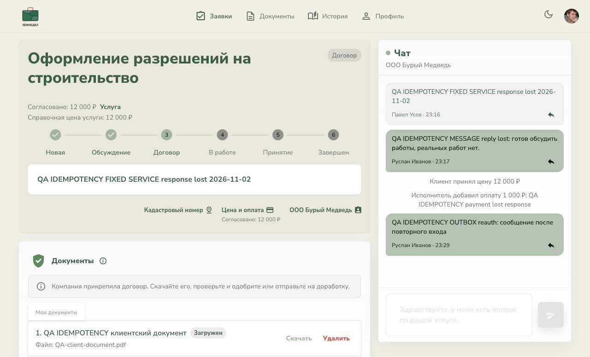
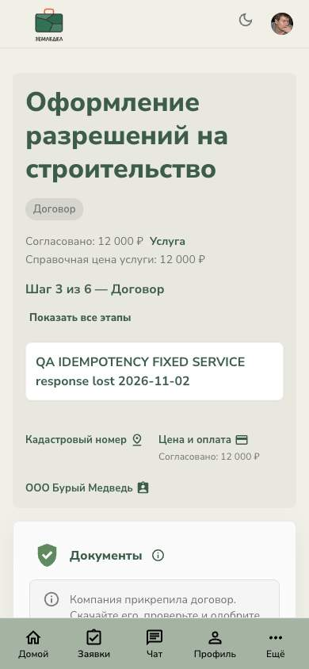
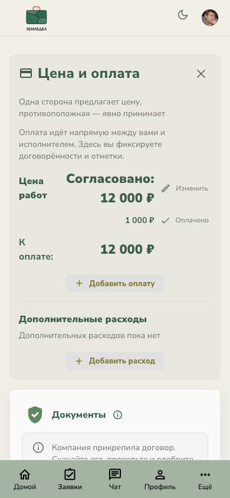
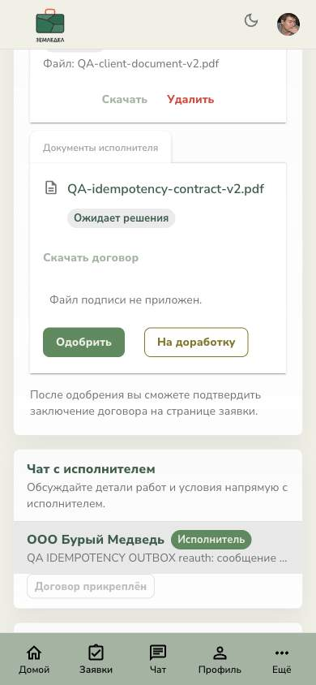

### Клиент: чаты
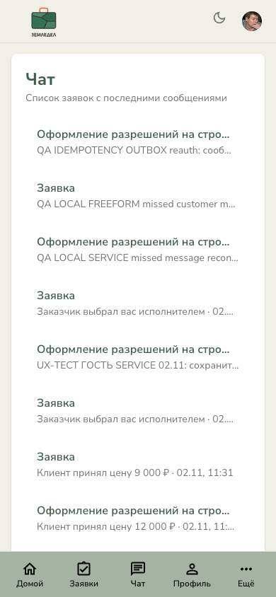
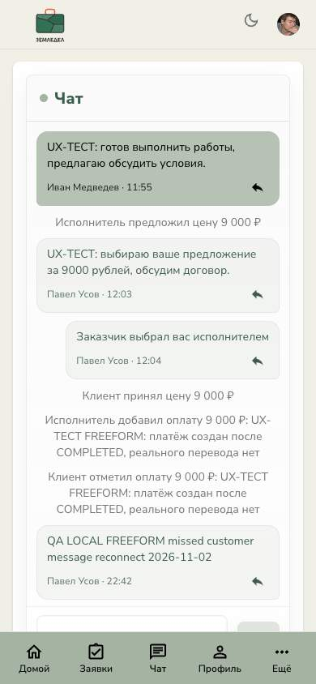

### Исполнитель: договор и рабочий день
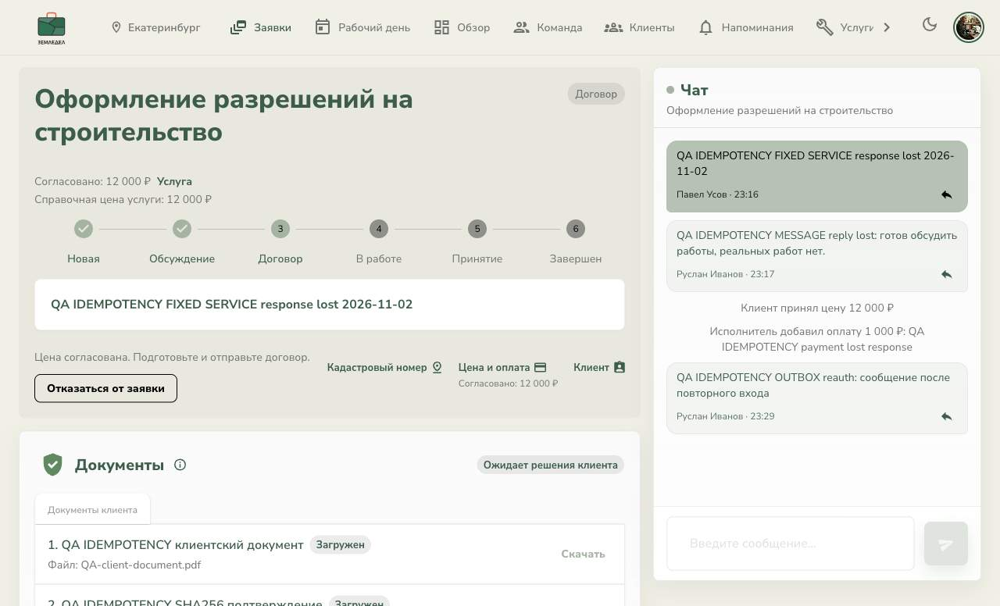
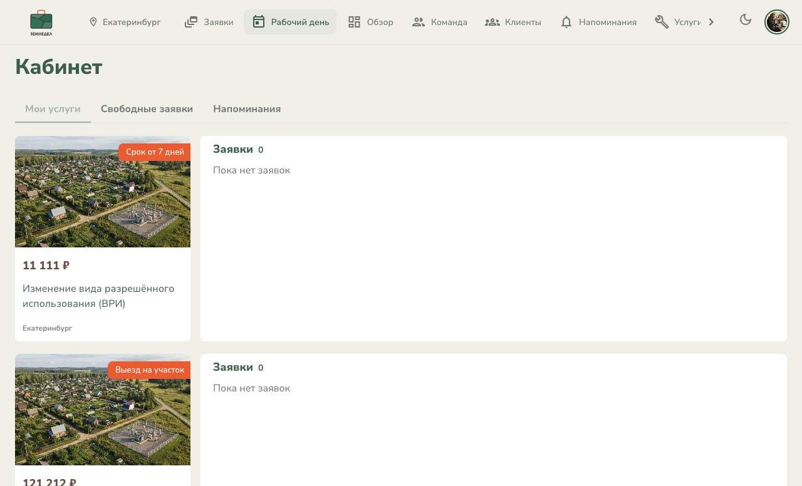
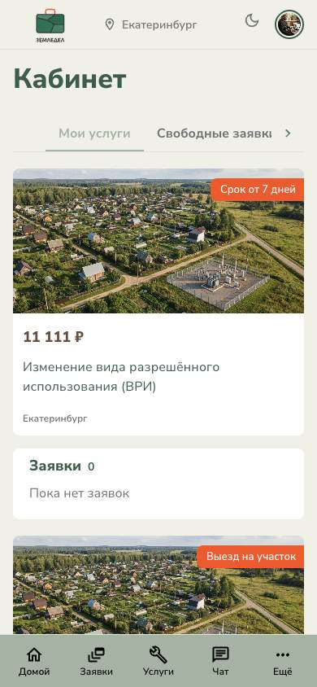

### Гость: главная и FREEFORM
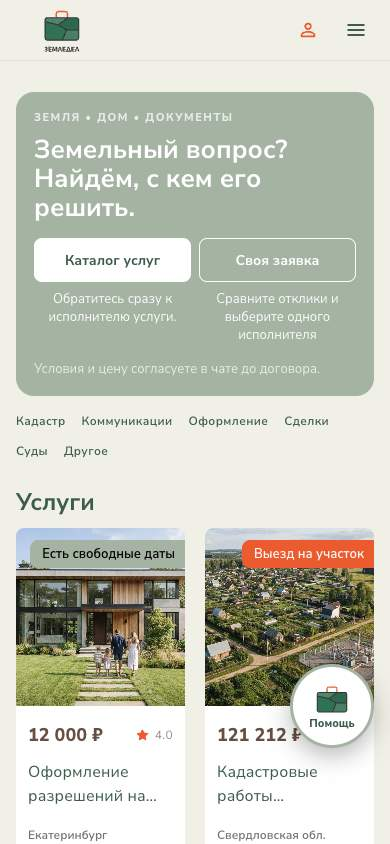

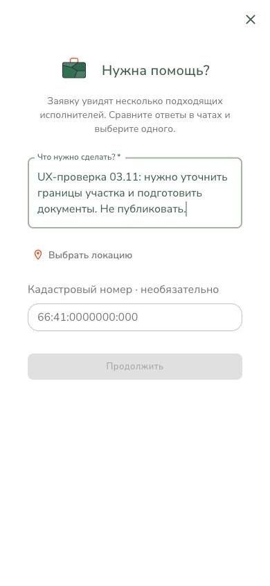
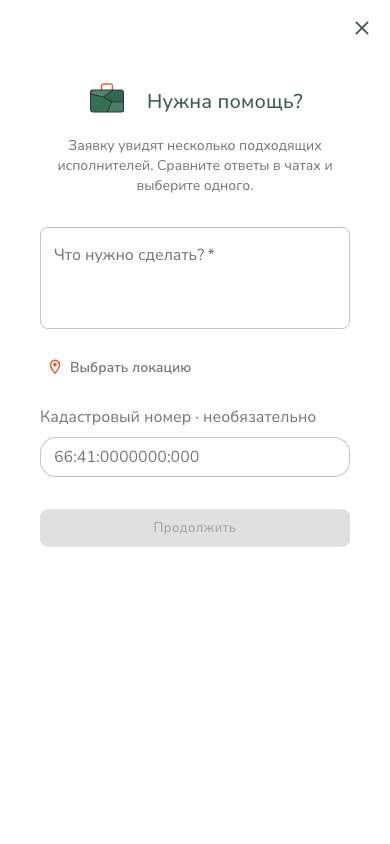

### Гость: SERVICE
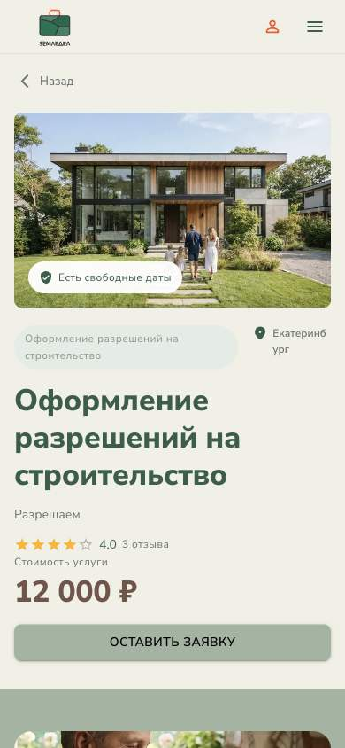
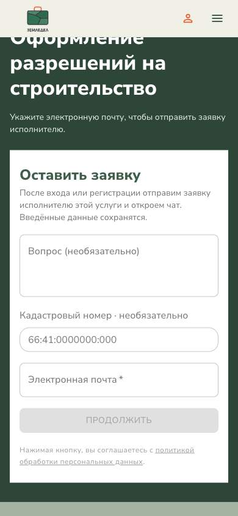

### Дополнительные состояния
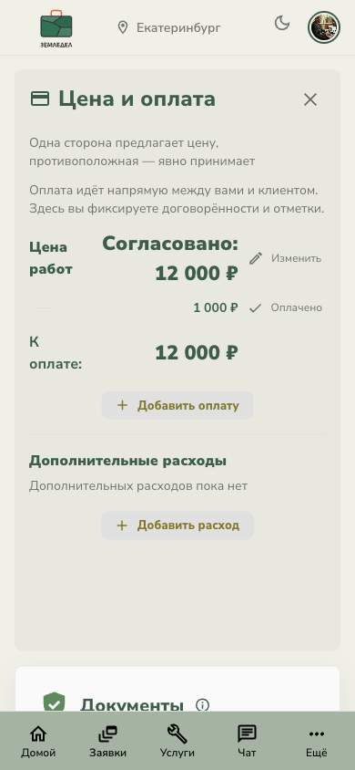
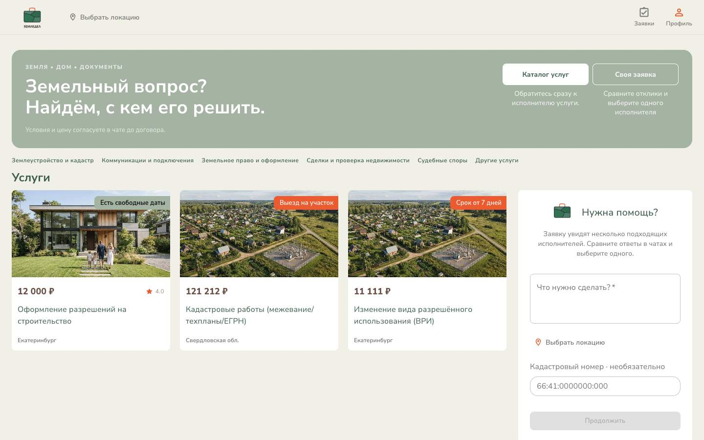
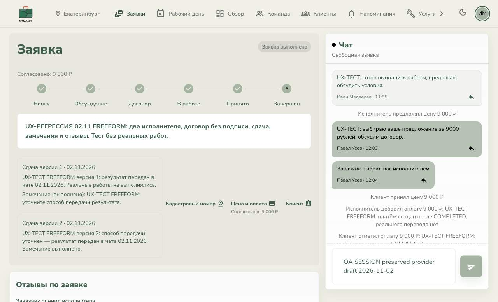
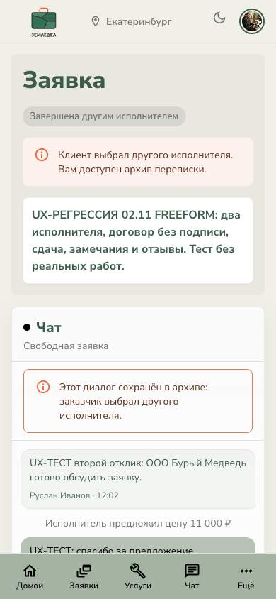
